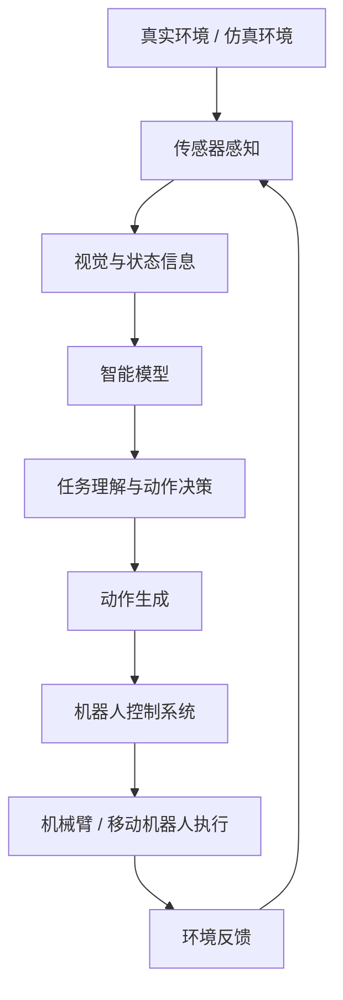
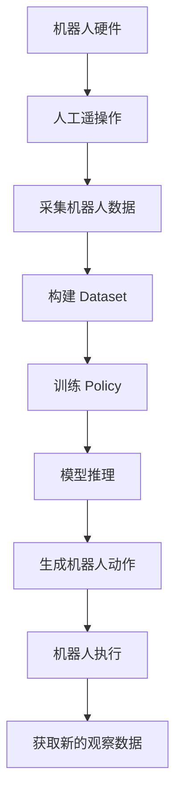
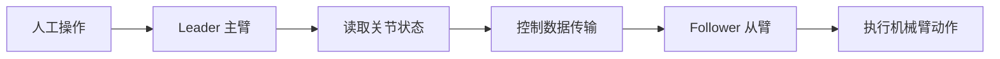
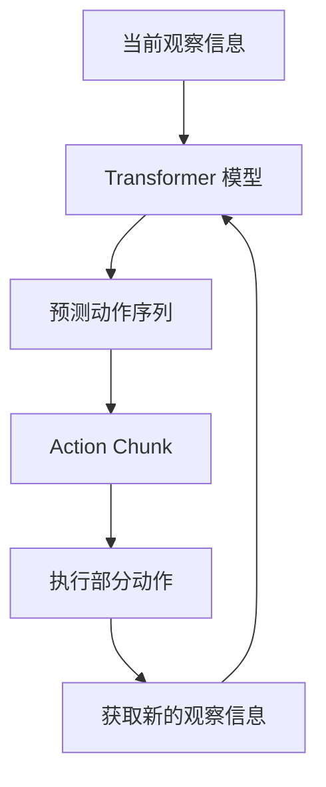
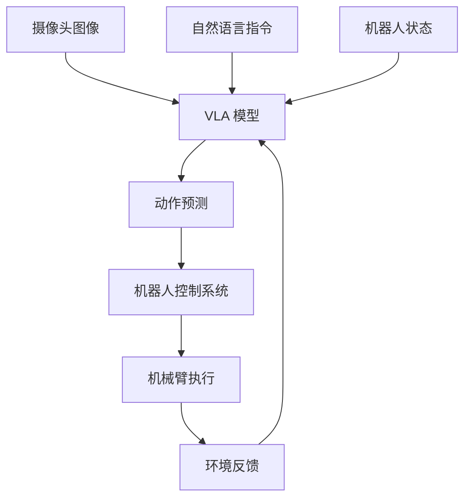
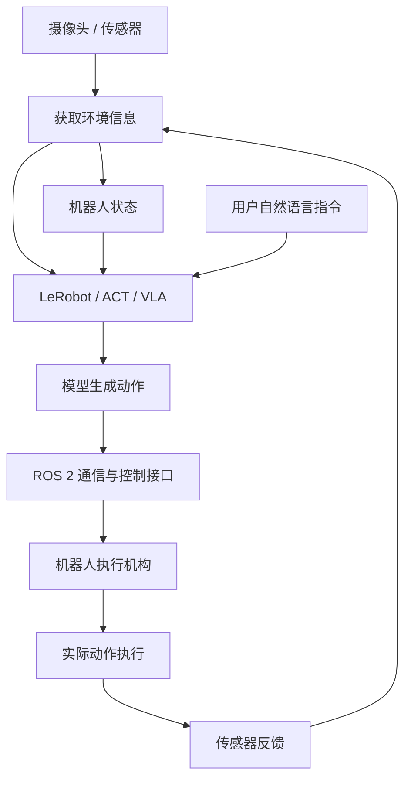
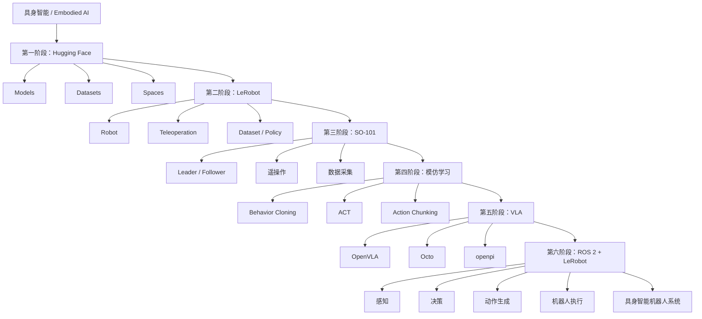

# 具身智能与机器人学习：从 Hugging Face、LeRobot 到 VLA 的完整学习路线

## 一、前言

随着人工智能的发展，机器人技术正在从传统的程序控制逐渐向数据驱动、模型驱动的智能控制方向发展。

传统机器人系统通常需要开发者提前编写控制逻辑，定义机器人在不同情况下应该执行什么动作。例如，检测到障碍物后停止运动，识别到目标物体后执行抓取。

这种方式能够完成相对固定的任务，但面对复杂环境时，往往需要开发者编写大量规则。

而具身智能（Embodied AI）关注的是让智能体通过身体与真实或仿真环境进行交互，利用视觉、语言、传感器信息以及动作反馈，逐渐学习如何完成任务。

例如：

- 机器人通过摄像头观察桌面。
- 理解人类提出的自然语言指令。
- 判断目标物体的位置。
- 规划机械臂的运动方式。
- 控制机械臂完成抓取。
- 根据执行结果调整后续动作。

这不仅涉及人工智能模型，还涉及机器人本体、传感器、数据采集、运动控制和环境交互等多个领域。

因此，学习具身智能不能只关注某一个模型，而是需要建立从数据、模型、机器人操作到自主决策与动作执行的完整知识体系。

本阶段准备从 Hugging Face 和 LeRobot 入手，逐步学习机器人数据集、预训练模型、SO-101 机械臂、模仿学习 ACT、视觉语言动作模型 VLA，并最终结合 ROS 2 实现机器人系统的集成。

---

## 二、具身智能的整体技术体系

### 2.1 什么是具身智能？

具身智能（Embodied AI）可以理解为：

**智能体通过自身的身体、传感器和执行机构与环境进行交互，从而感知环境、理解任务、作出决策并执行动作。**

它与传统纯软件人工智能的区别在于，具身智能不仅需要处理信息，还需要在物理环境中完成实际行动。

例如，普通视觉模型可以识别桌面上的一个杯子，但具身智能机器人还需要进一步完成：

1. 通过摄像头识别杯子。
2. 判断杯子的位置和姿态。
3. 理解用户要求抓取杯子。
4. 规划机械臂的运动。
5. 控制机械臂移动到目标位置。
6. 控制夹爪完成抓取。
7. 根据反馈判断抓取是否成功。

这意味着具身智能需要将感知、理解、决策和执行结合起来。

### 2.2 具身智能的整体工作流程

从机器人系统的角度，可以将其理解为以下流程：

整个系统形成一个持续循环：

**感知环境 → 理解任务 → 生成动作 → 执行动作 → 获取反馈 → 再次决策。**

其中：

| 模块 | 主要作用 |
|---|---|
| 感知 | 获取图像、关节状态和环境信息 |
| 数据集 | 提供机器人学习所需要的训练数据 |
| 模型 | 学习环境信息与动作之间的关系 |
| 决策 | 根据任务和当前状态确定下一步行动 |
| 动作生成 | 生成机器人需要执行的动作 |
| 控制系统 | 将动作转换为实际控制指令 |
| 执行机构 | 通过机械臂、夹爪或移动底盘完成任务 |
| 反馈 | 判断执行结果，为下一步动作提供信息 |

这里需要区分：具身智能模型负责学习和生成动作，并不意味着模型本身就能直接控制所有机器人硬件。实际执行仍然需要机器人控制系统提供接口、约束和安全保护。

---

## 三、Hugging Face：认识机器人学习资源平台

### 3.1 Hugging Face 是什么？

Hugging Face 是一个人工智能开源社区和资源平台。

它不仅提供各种预训练模型，还提供数据集、在线演示和模型开发相关工具。

对于具身智能学习来说，Hugging Face 可以作为进入机器人学习领域的起点。

官方网站：

https://huggingface.co/

主要关注三个部分：

- Models：模型资源。
- Datasets：数据集资源。
- Spaces：在线演示与应用。

### 3.2 Models：预训练模型

Models 主要用于查找和使用已经训练好的人工智能模型。

在具身智能领域，可以接触到：

- 视觉模型。
- 语言模型。
- 视觉语言模型。
- 视觉语言动作模型（VLA）。
- 机器人动作策略模型。

通过查看模型页面，可以了解：

1. 模型的用途。
2. 模型的结构。
3. 模型使用的数据集。
4. 模型的输入和输出。
5. 模型的使用方法。
6. 模型的训练和推理方式。

例如，后续学习 VLA 时，可以通过模型仓库了解 OpenVLA 等相关模型。

这里需要注意：

**预训练模型并不等于可以直接控制任意机器人。**

不同模型可能对应不同的机器人结构、动作空间、输入格式和控制接口。

### 3.3 Datasets：机器人数据集

Datasets 是具身智能学习中非常重要的一部分。

机器人模型需要大量数据来学习环境与动作之间的关系。

例如，机械臂执行抓取任务时，可以采集：

- 摄像头图像。
- 机械臂关节位置。
- 机械臂关节速度。
- 夹爪状态。
- 机器人执行的动作。
- 当前任务指令。

这些信息可以组成机器人学习数据。

一个机器人操作数据集通常由多个 Episode（任务执行片段）组成。

例如：

| Episode | 任务内容 |
|---|---|
| Episode 1 | 机械臂抓取红色方块 |
| Episode 2 | 机械臂抓取蓝色方块 |
| Episode 3 | 机械臂将方块放入指定位置 |
| Episode 4 | 机械臂重复完成物体搬运 |

通过大量不同场景下的操作数据，模型能够学习如何根据观察结果产生相应动作。

在后续学习 LeRobot 时，会进一步接触机器人数据集的组织形式和使用方法。

### 3.4 Spaces：在线演示与应用

Spaces 是 Hugging Face 提供的在线应用展示空间。

它允许开发者将模型和应用部署为可以交互的演示项目。

对于学习来说，可以通过 Spaces：

- 查看模型的实际运行效果。
- 体验视觉识别和语言模型应用。
- 了解模型输入与输出。
- 观察不同人工智能应用的交互方式。

Models、Datasets 和 Spaces 可以形成一个比较完整的学习入口：

| 模块 | 主要解决的问题 |
|---|---|
| Models | 使用什么模型？ |
| Datasets | 模型使用什么数据学习？ |
| Spaces | 模型实际运行起来是什么效果？ |

---

## 四、LeRobot：进入机器人学习与操作

### 4.1 LeRobot 是什么？

LeRobot 是 Hugging Face 推出的开源机器人学习项目。

项目地址：

https://github.com/huggingface/lerobot

官方文档：

https://huggingface.co/docs/lerobot/index

它的目标是降低机器人学习的开发门槛，让开发者能够使用开源工具完成机器人数据采集、数据管理、模型训练和策略推理。

在传统机器人开发中，我们通常需要关注：

- 机器人硬件。
- 传感器通信。
- 运动控制。
- 轨迹规划。
- 控制算法。

而在 LeRobot 中，可以进一步接触数据驱动的机器人学习流程。

它将机器人硬件、数据集和学习模型连接起来。

### 4.2 LeRobot 的核心组成

学习 LeRobot 时，重点关注以下几个概念：

| 核心概念 | 作用 |
|---|---|
| Robot | 机器人硬件及其接口 |
| Teleoperation | 通过人工操作控制机器人 |
| Dataset | 存储机器人操作数据 |
| Policy | 根据观察信息生成动作的策略模型 |
| Training | 使用数据训练策略模型 |
| Inference | 使用训练好的模型生成动作 |

可以将 LeRobot 的基本工作流程理解为：

这条流程非常重要，因为后续学习 ACT 和 VLA 时，都会涉及数据、模型和动作之间的关系。

### 4.3 为什么要先学习 LeRobot？

因为它能够将很多原本分散的知识连接起来。

例如：

- Hugging Face 让我们了解模型和数据集。
- LeRobot 让我们了解机器人如何采集和使用数据。
- SO-101 让我们有机会接触真实机械臂。
- ACT 让我们理解机器人如何通过示范数据学习动作。
- VLA 进一步将视觉和语言信息融入动作生成。

因此，LeRobot 可以作为进入具身智能实践的重要工具。

---

## 五、SO-101：通过机械臂理解机器人遥操作

### 5.1 SO-101 是什么？

SO-101 是 LeRobot 生态中非常值得关注的一套开源机械臂平台。

它通常采用 Leader-Follower（主从）结构。

其中：

- Leader：主臂，由人进行操作。
- Follower：从臂，根据主臂的操作执行对应动作。

通过这种方式，可以让人直接操作 Leader，由 Follower 完成对应的机器人动作。

### 5.2 什么是遥操作（Teleoperation）？

遥操作是指操作人员通过控制设备远程控制机器人执行动作。

在 SO-101 中，可以通过主臂的关节运动控制从臂。

例如：

1. 人操作 Leader 机械臂。
2. 系统读取 Leader 的关节状态。
3. 将关节状态转换为控制指令。
4. Follower 接收指令。
5. Follower 执行相应动作。

整体流程：

### 5.3 为什么要学习遥操作？

遥操作不仅仅是控制机械臂运动，更重要的是为机器人学习提供示范数据。

例如：

人通过 Leader 操作机械臂完成一次抓取任务。

系统可以同时记录：

- 相机观察到的画面。
- Leader 或机器人对应的关节状态。
- Follower 执行的动作。
- 任务执行过程中的时间信息。

这样就得到了一段机器人操作示范。

将多次操作记录下来，就可以形成用于训练模型的数据集。

这也是后续学习模仿学习和 ACT 的基础。

---

## 六、模仿学习：让机器人从示范中学习

### 6.1 什么是模仿学习？

模仿学习（Imitation Learning）是一种通过专家示范数据，让模型学习如何执行任务的方法。

在机器人领域，专家可以是人类操作人员。

例如：

人类通过遥操作控制机械臂完成抓取任务。

系统记录每个时刻的观察信息和对应动作：

\[
D=\{(o_t,a_t)\}
\]

其中：

- \(o_t\)：机器人在时刻 \(t\) 的观察信息。
- \(a_t\)：机器人在时刻 \(t\) 执行的动作。

模型通过大量示范数据，学习观察信息与动作之间的关系：

\[
\pi(a_t|o_t)
\]

这里的 \(\pi\) 表示机器人策略。

训练完成后，模型可以根据新的观察信息预测应该执行什么动作。

### 6.2 行为克隆（Behavior Cloning）

行为克隆是模仿学习中一种常见的方法。

它的核心思想是：

**将专家示范数据作为训练样本，让模型学习模仿专家的动作。**

例如：

| 观察信息 | 专家动作 |
|---|---|
| 目标物体在左侧 | 机械臂向左移动 |
| 目标物体在右侧 | 机械臂向右移动 |
| 夹爪接近物体 | 执行夹取 |
| 物体已经抓取 | 移动到目标位置 |

模型通过学习这些样本，逐渐建立观察与动作之间的关系。

不过，行为克隆也存在局限性。

如果模型在实际执行时遇到了训练数据中很少出现的场景，可能会产生不准确的动作。

因此，机器人学习还需要考虑数据质量、场景多样性和执行反馈。

---

## 七、ACT：Action Chunking with Transformers

### 7.1 ACT 是什么？

ACT 全称为 Action Chunking with Transformers。

它是一种用于机器人操作的模仿学习方法。

与简单地预测下一时刻的单个动作不同，ACT 的核心思想是：

**让模型一次预测一段连续的动作序列，也就是 Action Chunk（动作块）。**

例如，机械臂执行抓取任务时，动作可能包含：

1. 机械臂移动到物体上方。
2. 机械臂下降。
3. 夹爪闭合。
4. 机械臂抬起。
5. 移动到目标区域。

传统的单步动作预测需要不断预测下一步动作。

而 Action Chunking 可以让模型一次预测一段连续动作。

### 7.2 为什么需要 Action Chunking？

如果机器人每个控制周期都只预测一个动作，就需要频繁调用模型。

这种方式可能带来：

- 推理调用频繁。
- 单步预测容易受到局部误差影响。
- 动作连续性需要额外考虑。

ACT 通过预测一段动作序列，使机器人能够在一定程度上学习连续动作之间的关系。

可以用下面的方式理解：

这里并不是说预测出来的所有动作都必须一次性执行到底。实际系统可以根据控制策略执行部分动作，再获取新的观察信息并进行下一次推理。

### 7.3 ACT 的学习重点

学习 ACT 时，需要重点理解：

- Transformer 在模型中发挥什么作用。
- 输入的视觉和机器人状态信息是什么。
- 模型如何预测动作序列。
- Action Chunking 为什么能够帮助机器人学习连续动作。
- ACT 如何利用人类示范数据训练。
- 训练好的模型如何进行机器人动作推理。

ACT 是从传统机器人控制向数据驱动机器人操作学习过渡的重要一步。

---

## 八、VLA：视觉语言动作模型

### 8.1 什么是 VLA？

VLA（Vision-Language-Action）是视觉语言动作模型。

它将视觉信息、自然语言指令和机器人动作联系起来。

可以将其理解为：

- Vision：机器人看到了什么。
- Language：机器人需要完成什么任务。
- Action：机器人应该执行什么动作。

例如，人类向机器人下达指令：

“把桌面上的红色方块放到盒子里。”

机器人需要：

1. 通过视觉识别桌面上的物体。
2. 理解自然语言指令。
3. 判断红色方块的位置。
4. 根据当前机器人状态生成动作。
5. 控制机械臂完成抓取和放置。

整体流程：

### 8.2 VLA 与 ACT 的区别

ACT 和 VLA 都可以用于机器人动作学习，但两者的侧重点不同。

| 对比项目 | ACT | VLA |
|---|---|---|
| 主要方向 | 基于示范数据的机器人模仿学习 | 视觉、语言与动作联合建模 |
| 输入 | 视觉和机器人状态等信息 | 视觉、语言以及具体实现所需的状态信息 |
| 输出 | 一段机器人动作序列 | 机器人动作或动作表示 |
| 核心特点 | Action Chunking | Vision + Language + Action |
| 学习重点 | 如何模仿专家完成操作 | 如何根据视觉和语言任务生成动作 |

可以这样理解：

ACT 重点研究如何让机器人模仿人类示范，学习连续动作。

VLA 则进一步关注如何让机器人结合视觉信息和语言指令完成任务。

需要注意，VLA 并不意味着机器人已经拥有完整的人类式推理能力。不同 VLA 模型在任务理解、规划、动作表示和泛化能力方面存在差异。

### 8.3 需要关注的 VLA 开源项目

后续学习时，可以重点了解以下项目：

| 项目 | 学习方向 |
|---|---|
| OpenVLA | 开源视觉语言动作模型 |
| Octo | 通用机器人策略模型 |
| openpi | 机器人策略模型与相关工具 |
 
这些项目可以帮助理解不同 VLA 和机器人策略模型的架构、数据和推理方式。

---

## 九、机器人仿真与具身智能实验环境

具身智能不仅需要学习模型，还需要通过仿真环境和真实机器人验证模型效果。

在之前的学习路线中，还涉及以下几个平台。

### 9.1 MuJoCo

MuJoCo 是一种物理仿真引擎。

它可以模拟机器人与环境之间的物理交互，例如：

- 机器人关节运动。
- 刚体动力学。
- 物体碰撞。
- 接触与摩擦。
- 机器人操作任务。

可以用它理解机器人在物理环境中的运动行为。

### 9.2 ManiSkill

ManiSkill 是面向机器人操作学习的仿真与基准平台。

可以用于研究：

- 机器人抓取。
- 物体搬运。
- 机械臂操作。
- 强化学习。
- 模仿学习。

它可以为机器人操作算法提供仿真任务和实验环境。

### 9.3 Isaac Lab

Isaac Lab 是基于 NVIDIA Isaac Sim 的机器人学习框架。

它面向机器人仿真、强化学习和大规模并行训练等应用。

后续可以通过它了解：

- 机器人仿真环境。
- 物理交互。
- 机器人运动控制。
- 强化学习训练。
- 仿真到现实迁移（Sim-to-Real）。

### 9.4 仿真平台的定位

| 平台 | 主要学习方向 |
|---|---|
| MuJoCo | 物理仿真和机器人动力学 |
| ManiSkill | 机器人操作任务与学习 |
| Isaac Lab | 大规模机器人仿真和学习 |

这些平台不需要一开始全部深入学习，可以根据后续项目需求逐步接触。

---

## 十、具身智能生态中的其他学习平台

除了 Hugging Face 和 LeRobot，还可以关注其他开源项目和社区。

| 平台 / 项目 | 主要方向 | 学习价值 |
|---|---|---|
| Embodied AI Hub / EAI2 | 具身智能资源与项目 | 了解具身智能生态 |
| Open X-Embodiment | 多机器人操作数据集 | 理解跨机器人数据和训练 |
| robomimic | 机器人模仿学习研究框架 | 学习行为克隆等方法 |
| OpenVLA | 视觉语言动作模型 | 了解 VLA 模型 |
| Octo | 通用机器人策略模型 | 了解通用机器人策略 |
| openpi | 机器人策略模型与工具 | 学习机器人模型训练和推理 |

其中：

**Open X-Embodiment** 值得重点关注，因为它涉及来自不同机器人平台的操作数据，有助于理解机器人学习为什么需要多样化数据，以及不同机器人之间如何共享学习经验。

**robomimic** 则可以帮助理解模仿学习的研究方法和实验流程。

这些项目与 Hugging Face、LeRobot 并不是完全相同类型的平台，而是分别从数据、模型、训练框架和实验生态等不同方向支持机器人学习。

---

## 十一、ROS 2 + LeRobot：从模型学习到机器人实际执行

### 11.1 为什么还需要 ROS 2？

前面学习了 Hugging Face、LeRobot、SO-101、ACT 和 VLA。

但这些知识还不足以构建一个完整的机器人系统。

因为模型生成动作之后，还需要通过实际机器人控制系统将动作执行出来。

这就涉及 ROS 2。

ROS 2 是机器人开发中常用的通信与软件框架，可以负责：

- 节点之间的通信。
- 传感器数据传输。
- 机器人状态管理。
- 运动控制接口。
- 坐标变换。
- 机器人系统集成。

而 LeRobot 更关注机器人学习相关的硬件接口、数据采集、数据集管理和策略模型训练推理。

两者可以在系统层面进行集成，但并不是相互替代的关系。

### 11.2 ROS 2 与 LeRobot 的分工

| 技术 | 主要职责 |
|---|---|
| ROS 2 | 机器人通信、传感器、状态管理和控制集成 |
| LeRobot | 机器人数据采集、数据集、模型训练和策略推理 |
| ACT / VLA | 根据观察信息生成机器人动作 |
| 机器人硬件 | 实际执行动作 |

可以将它们理解为不同层次的技术：

模型负责生成动作，LeRobot 提供学习与推理流程，ROS 2 可以负责系统通信和控制集成，最终由机器人硬件执行。

具体采用什么通信接口，需要根据机器人硬件和软件架构决定。

### 11.3 最终系统工作流程

例如：

用户说：“把桌面上的红色方块放进盒子里。”

系统可以按照以下步骤工作：

1. 摄像头获取桌面图像。
2. 系统获取机械臂当前状态。
3. 模型根据视觉信息和语言指令理解任务。
4. 模型生成机械臂动作。
5. 控制系统将动作转换为机器人能够执行的指令。
6. 机械臂执行抓取和放置。
7. 系统再次获取环境信息，判断任务执行情况。

最终形成一个完整的感知、决策、执行和反馈闭环。

---

## 十二、完整学习路线规划

结合前面介绍的技术和项目，将具身智能学习划分为六个阶段。

### 第一阶段：Hugging Face 基础

学习目标：认识人工智能模型、数据集和在线应用资源。

主要内容：

- Hugging Face 平台介绍。
- Models 模型仓库。
- Datasets 数据集仓库。
- Spaces 在线应用。
- 预训练模型的基本使用。
- 机器人数据集的基本结构。

阶段成果：

能够独立查找模型和数据集，理解模型页面的基本信息，认识机器人学习数据的组织形式。

### 第二阶段：LeRobot 基础

学习目标：理解机器人学习框架的整体工作流程。

主要内容：

- LeRobot 项目架构。
- Robot 机器人接口。
- Teleoperation 遥操作。
- Dataset 数据集。
- Policy 策略模型。
- Training 模型训练。
- Inference 模型推理。

阶段成果：

能够理解 LeRobot 如何连接机器人硬件、数据集和学习模型。

### 第三阶段：SO-101 机械臂与遥操作

学习目标：理解真实机器人操作数据是如何产生的。

主要内容：

- SO-101 机械臂结构。
- Leader 主臂与 Follower 从臂。
- 机械臂关节。
- 遥操作原理。
- 相机数据采集。
- Episode 数据记录。
- 机器人数据集生成。

阶段成果：

理解通过人工遥操作采集机器人操作数据的完整过程。

### 第四阶段：模仿学习与 ACT

学习目标：理解机器人如何通过示范数据学习动作。

主要内容：

- 模仿学习。
- Behavior Cloning。
- 观察信息与动作数据。
- ACT 算法。
- Transformer 基础。
- Action Chunking。
- 模型训练与推理。

阶段成果：

能够解释机器人如何利用人类示范数据学习连续动作，并理解 ACT 的核心机制。

### 第五阶段：VLA 视觉语言动作模型

学习目标：理解机器人如何结合视觉和自然语言指令生成动作。

主要内容：

- VLA 基本概念。
- Vision、Language、Action。
- 视觉语言模型。
- OpenVLA。
- Octo。
- openpi。
- VLA 模型输入与输出。
- 机器人任务执行。

阶段成果：

能够理解 VLA 的基本架构，认识视觉、语言和机器人动作之间的联系。

### 第六阶段：ROS 2 + LeRobot 综合实践

学习目标：将机器人学习模型与机器人系统结合起来。

主要内容：

- ROS 2 与 LeRobot 的系统集成。
- 传感器数据获取。
- 机器人状态管理。
- 模型推理接口。
- 动作指令传输。
- 机械臂控制。
- 任务执行反馈。
- 仿真与真实机器人验证。

阶段成果：

尝试构建一个能够感知环境、理解任务、生成动作并控制机器人执行任务的完整系统。

---

## 十三、总体学习路线图

将所有阶段连接起来，可以得到以下学习路线：

最终形成：

**数据资源 → 机器人操作 → 数据采集 → 模仿学习 → 智能模型 → 自主决策 → 动作执行。**

---

## 十四、总结与学习目标

通过这条学习路线，希望逐步完成从传统机器人开发向具身智能与机器人学习方向的知识扩展。

之前学习 ROS 2 时，主要关注节点通信、TF 坐标变换、Gazebo 仿真、机器人模型、路径规划和导航控制。

这些内容解决的是机器人如何感知环境、进行通信以及执行运动控制的问题。

而具身智能进一步关注：

**机器人能不能通过数据学习任务？能不能理解人类指令？能不能根据环境变化自主生成动作？**

这也是本次学习路线的核心方向。

从 Hugging Face 开始，认识模型与数据集；通过 LeRobot 理解机器人学习框架；利用 SO-101 理解机械臂遥操作和数据采集；通过模仿学习和 ACT 理解机器人如何从示范中学习动作；进一步学习 VLA，理解视觉、语言和动作之间的联系；最后结合 ROS 2，将模型与实际机器人控制系统连接起来。

需要明确的是，具身智能并不是简单地将一个 AI 模型接到机器人上，而是需要数据、模型、机器人本体、控制系统和环境反馈共同配合。

**最终学习目标：能够理解具身智能的整体技术架构，掌握机器人数据采集与模仿学习的基本流程，理解 ACT 和 VLA 的核心思想，并尝试结合 ROS 2 与 LeRobot，实现机器人从环境感知、任务理解到自主动作执行的完整闭环。**

这将是从传统 ROS 2 机器人开发走向具身智能与智能机器人开发的重要一步。

---

## 参考资料

- [Hugging Face 官网](https://huggingface.co/)
- [Hugging Face Models](https://huggingface.co/models)
- [Hugging Face Datasets](https://huggingface.co/datasets)
- [Hugging Face Spaces](https://huggingface.co/spaces)
- [LeRobot GitHub](https://github.com/huggingface/lerobot)
- [LeRobot 官方文档](https://huggingface.co/docs/lerobot/index)
- [Open X-Embodiment](https://robotics-transformer-x.github.io/)
- [robomimic](https://robomimic.github.io/)
- [OpenVLA](https://openvla.github.io/)
- [Octo](https://octo-models.github.io/)
- [MuJoCo](https://mujoco.org/)
- [ManiSkill](https://maniskill.ai/)
- [NVIDIA Isaac Lab](https://isaac-sim.github.io/IsaacLab/)
