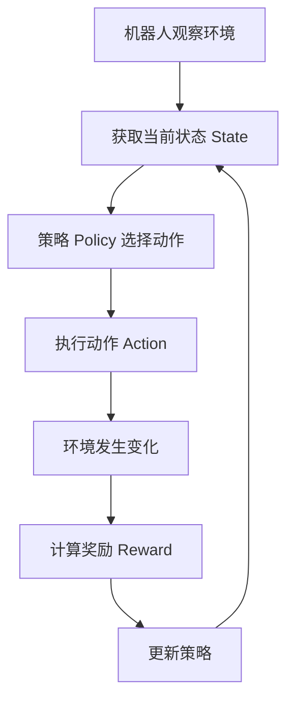
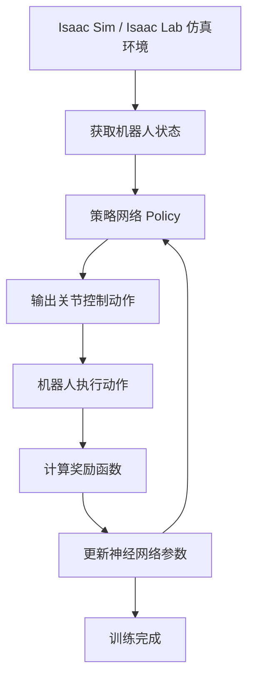
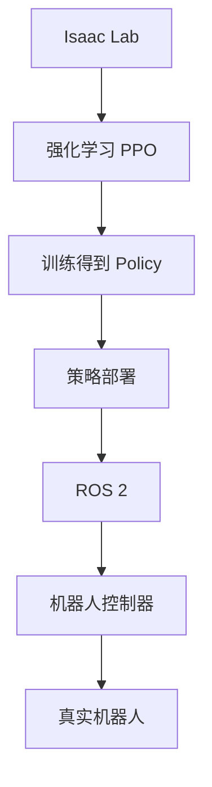
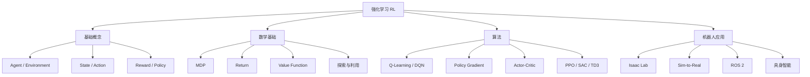

# 强化学习（RL）：让机器人通过试错学会自主决策

## 一、什么是强化学习？

### 1.1 强化学习的基本概念

强化学习（Reinforcement Learning，简称 RL）是机器学习的重要分支。

它的核心思想是：让智能体（Agent）不断与环境（Environment）进行交互，根据环境反馈的奖励（Reward）和惩罚，逐渐学习出能够获得更高长期收益的行动策略。

与监督学习不同，强化学习通常不需要人为提供每一步的标准答案，而是通过不断试错，让智能体自己寻找完成任务的方法。

例如，让一个人形机器人学习走路：

- 机器人成功向前移动，获得奖励。
- 机器人保持身体平衡，获得奖励。
- 机器人摔倒，受到惩罚。
- 机器人通过不断训练，逐渐学会如何保持平衡并向前行走。

### 1.2 强化学习的五个核心组成部分

| 概念 | 英文 | 含义 | 机器人案例 |
|---|---|---|---|
| 智能体 | Agent | 执行学习和决策的主体 | 人形机器人 |
| 环境 | Environment | 智能体进行交互的外部世界 | 仿真场景 |
| 状态 | State | 当前环境和智能体的信息 | 关节角度、身体姿态 |
| 动作 | Action | 智能体执行的行为 | 行走、转向、出拳 |
| 奖励 | Reward | 环境对动作结果的评价 | 向前移动加分、摔倒扣分 |

### 1.3 强化学习的基本工作流程

整个过程不断循环。

机器人并不是一开始就知道正确动作，而是通过大量训练逐渐优化自己的策略。

---

## 二、强化学习的数学基础：MDP

### 2.1 什么是 MDP？

MDP（Markov Decision Process，马尔可夫决策过程）是强化学习中常用的数学建模框架。

它描述了智能体如何在一个不断变化的环境中，根据当前状态选择动作，并获得奖励。

MDP 通常包含五个要素：

\[
MDP=(S,A,P,R,\gamma)
\]

| 符号 | 含义 | 解释 |
|---|---|---|
| S | 状态空间 | 机器人可能处于的所有状态 |
| A | 动作空间 | 机器人可以执行的所有动作 |
| P | 状态转移概率 | 执行动作后环境如何变化 |
| R | 奖励函数 | 环境如何评价动作结果 |
| γ | 折扣因子 | 未来奖励的重要程度 |

例如，人形机器人学习行走：

- S：当前身体姿态、关节角度、速度。
- A：各个关节的控制指令。
- P：执行动作后，机器人姿态如何变化。
- R：是否向前移动、是否保持平衡。
- γ：当前奖励和未来奖励各自有多重要。

### 2.2 什么是马尔可夫性质？

马尔可夫性质可以简单理解为：

**未来状态主要取决于当前状态和当前动作，而不需要直接依赖完整的历史过程。**

例如：

机器人当前的关节角度、速度和身体姿态已经能够描述其当前运动状态，那么预测下一时刻的状态时，可以利用这些信息和当前控制动作。

数学表达：

\[
P(s_{t+1}|s_t,a_t,\text{历史})
=
P(s_{t+1}|s_t,a_t)
\]

注意：真实机器人并不一定能够直接观测到完整状态，因此实际任务也可能采用部分可观测模型（POMDP）。

### 2.3 什么是回报 Return？

强化学习不仅关注当前动作获得多少奖励，还关注未来能够获得多少奖励。

假设机器人连续行走：

- 第一步获得 2 分。
- 第二步获得 3 分。
- 第三步获得 5 分。

那么机器人需要考虑整个过程的累计收益，而不是只关注某一步。

折扣累计回报：

\[
G_t=\sum_{k=0}^{\infty}\gamma^k r_{t+k}
\]

其中：

- \(G_t\)：从当前时刻开始的累计回报。
- \(r_t\)：当前奖励。
- \(\gamma\)：折扣因子，通常在 0 到 1 之间。

折扣因子越大，机器人越重视长期收益；越小，则越重视眼前奖励。

---

## 三、奖励函数与策略：强化学习的核心

### 3.1 什么是奖励函数？

Reward Function（奖励函数）是强化学习中用于评价智能体行为的规则。

它告诉机器人什么行为值得鼓励，什么行为需要避免。

例如，让机器人学习走路：

| 行为 | 奖励设计 |
|---|---:|
| 向前移动 | +5 |
| 保持身体平衡 | +3 |
| 双脚正常交替 | +2 |
| 身体剧烈晃动 | -5 |
| 机器人摔倒 | -20 |

这些数值只是教学示例，并不是实际训练中的固定标准。

### 3.2 密集奖励与稀疏奖励

**稀疏奖励（Sparse Reward）**

只有在完成目标时才获得奖励。

例如：

- 成功走到终点：+100。
- 没有完成任务：0。

优点：目标明确。

缺点：机器人很难知道应该如何逐步完成任务。

**密集奖励（Dense Reward）**

在任务执行过程中，根据不同的行为持续给予奖励。

例如：

- 向前移动：+2。
- 保持平衡：+3。
- 减少身体晃动：+2。
- 摔倒：-20。

优点：能够提供更加及时的学习反馈。

缺点：奖励设计不合理时，机器人可能学会利用规则漏洞，而不是真正完成任务。

### 3.3 什么是 Reward Hacking？

Reward Hacking（奖励投机）是指智能体找到了获得高奖励的方法，但这种方法并没有真正实现设计者想要的目标。

例如：

原本希望机器人通过正常行走向前移动。

但是奖励函数只奖励向前速度，没有惩罚身体倾倒。

机器人可能学会通过向前摔倒来获得较高的速度奖励。

这说明：

**奖励函数设计得好不好，直接影响机器人最终学会什么行为。**

### 3.4 什么是 Policy？

Policy（策略）是强化学习中决定智能体如何行动的规则。

简单来说，就是：

给定当前状态，机器人应该采取什么动作。

数学表达：

\[
a_t=\pi(s_t)
\]

其中：

- \(s_t\)：当前状态。
- \(a_t\)：选择的动作。
- \(\pi\)：策略函数。

例如：

机器人发现自己身体向左倾斜，就通过策略调整相关关节，使身体重新保持平衡。

### 3.5 什么是 Value Function？

Value Function（价值函数）用于评价某个状态或者状态与动作组合的长期价值。

主要分为两种：

**状态价值函数 V(s)**

评价机器人处于某个状态时，未来能够获得多少累计奖励。

**动作价值函数 Q(s,a)**

评价机器人在某个状态下执行某个动作后，未来能够获得多少累计奖励。

| 类型 | 主要作用 | 示例 |
|---|---|---|
| V(s) | 评价当前状态 | 机器人当前姿态是否有利于继续行走 |
| Q(s,a) | 评价状态与动作 | 当前姿态下，向左迈步是否更合适 |

### 3.6 探索与利用

强化学习还需要解决一个重要问题：机器人究竟应该尝试新动作，还是使用已经学会的动作？

这就是 Exploration vs Exploitation（探索与利用）。

- 探索（Exploration）：尝试不同的动作，寻找更好的方法。
- 利用（Exploitation）：使用已经学习到的策略，获得预期收益。

例如：

机器人已经学会向前迈右腿，但是还不知道先迈左腿是否更稳定。

此时尝试左腿，就是探索；继续使用右腿，就是利用。

两者需要保持平衡。

---

## 四、常见强化学习算法

强化学习算法有很多种，可以从不同角度进行分类。

### 4.1 Q-Learning

Q-Learning 是一种经典的基于价值的强化学习算法。

它通过学习 Q 表，记录不同状态下执行不同动作所能获得的预期收益。

核心思想：

不断更新 Q 值，让智能体逐渐知道在不同状态下选择什么动作更好。

Q-Learning 的更新公式：

\[
Q(s,a)\leftarrow Q(s,a)+
\alpha[r+\gamma\max_{a'}Q(s',a')-Q(s,a)]
\]

其中：

- α：学习率。
- r：当前奖励。
- γ：折扣因子。
- Q(s,a)：当前动作价值。
- max Q(s',a')：下一状态下能够获得的最大动作价值。

它适合状态和动作空间较小的任务。

对于具有大量关节和连续控制动作的人形机器人，传统 Q 表难以直接使用。

### 4.2 DQN

DQN（Deep Q-Network）是在 Q-Learning 基础上引入深度神经网络的方法。

传统 Q-Learning 使用表格保存 Q 值，而 DQN 使用神经网络估计 Q 值。

它主要引入两个重要机制：

1. 经验回放（Experience Replay）：将过去的训练经验存储起来，随机抽取进行训练。
2. 目标网络（Target Network）：使用单独的目标网络计算训练目标，提高训练稳定性。

DQN 主要用于离散动作空间。

例如：

机器人可以选择前进、后退、左转、右转等有限动作。

### 4.3 PPO

PPO（Proximal Policy Optimization，近端策略优化）是一种基于策略梯度的强化学习算法。

它通过优化策略网络，让机器人逐渐学会更好的动作选择。

PPO 的一个重要特点是限制每次策略更新的幅度，避免策略发生过大的变化。

其核心思想是：

**既要让策略变得更好，也要避免一次更新改变得太剧烈。**

PPO 通常采用 Actor-Critic 架构：

- Actor：负责根据当前状态选择动作。
- Critic：负责评价当前状态的价值。

PPO 常用于机器人连续运动控制，例如：

- 人形机器人行走。
- 四足机器人运动。
- 机械臂动作控制。
- 机器人平衡控制。

### 4.4 SAC

SAC（Soft Actor-Critic）是一种基于最大熵强化学习的算法。

除了追求较高的奖励，它还鼓励策略保持一定的随机性和探索能力。

简单理解：

机器人不仅要学会选择收益高的动作，还要保留尝试其他动作的能力。

SAC 适合连续动作控制任务。

### 4.5 TD3

TD3（Twin Delayed Deep Deterministic Policy Gradient）是针对连续动作控制改进的强化学习算法。

它主要采用三个改进：

1. 双 Q 网络：减少价值估计过高的问题。
2. 延迟策略更新：降低策略更新的不稳定性。
3. 目标策略平滑：提高训练稳定性。

常用于机械臂控制和连续运动控制任务。

### 4.6 常见算法对比

| 算法 | 学习方式 | 动作空间 | 主要特点 |
|---|---|---|---|
| Q-Learning | 价值学习 | 离散 | 经典表格方法 |
| DQN | 深度价值学习 | 离散 | 神经网络估计 Q 值 |
| PPO | 策略优化 | 离散/连续 | 更新相对稳定 |
| SAC | 最大熵策略优化 | 连续 | 强调探索 |
| TD3 | Actor-Critic | 连续 | 改善价值估计 |

对于机器人学习，建议重点掌握 PPO，再进一步学习 SAC 和 TD3。

---

## 五、强化学习如何应用于机器人？

### 5.1 机器人强化学习训练架构

以 Isaac Lab 中的人形机器人行走训练为例：

具体训练过程：

1. 在仿真环境中创建机器人模型。
2. 获取关节角度、关节速度、身体姿态等信息。
3. 将状态输入策略网络。
4. 策略网络输出关节控制指令。
5. 仿真环境执行动作。
6. 根据行走距离、身体平衡、能耗等计算奖励。
7. 算法根据训练结果更新网络参数。
8. 重复大量训练，直到机器人能够稳定完成任务。

### 5.2 为什么使用 Isaac Lab？

Isaac Lab 是基于 NVIDIA Isaac Sim 构建的机器人学习框架，提供机器人仿真、强化学习训练和任务环境等功能。

它可以帮助开发者：

- 创建机器人仿真环境。
- 定义机器人状态和动作。
- 设计奖励函数。
- 使用强化学习算法训练机器人。
- 进行大量并行仿真训练。

与真实机器人相比，仿真训练可以降低训练成本，避免大量试错对硬件造成损伤。

### 5.3 什么是 Sim-to-Real？

Sim-to-Real（Simulation to Reality）指从仿真环境向真实环境迁移。

例如：

先在 Isaac Lab 中训练一个能够稳定行走的人形机器人，再将训练得到的策略部署到真实机器人上。

但是，仿真环境和真实世界并不完全一致：

| 仿真环境 | 真实环境 |
|---|---|
| 理想化物理参数 | 实际物理参数存在误差 |
| 传感器噪声可控 | 存在真实传感器噪声 |
| 摩擦系数可设置 | 地面摩擦条件不断变化 |
| 控制延迟可配置 | 存在实际通信与执行延迟 |

因此，通常还需要使用 Domain Randomization（域随机化）。

域随机化就是在仿真训练时，随机改变质量、摩擦系数、传感器噪声等参数，让机器人适应不同条件，提高迁移到真实环境后的适应能力。

---

## 六、强化学习与具身智能的关系

### 6.1 强化学习、模仿学习与 VLA

这三者都是机器人学习领域的重要方向，但学习方式不同。

| 技术 | 核心思想 | 学习来源 |
|---|---|---|
| 强化学习 RL | 通过试错优化行为 | 奖励反馈 |
| 模仿学习 IL | 学习专家示范 | 示范数据 |
| VLA | 建立视觉、语言与动作之间的联系 | 多模态数据 |

例如，让机械臂学习抓取杯子：

- 强化学习：机械臂不断尝试，根据是否成功抓取获得奖励。
- 模仿学习：机械臂学习人类遥操作抓取杯子的示范。
- VLA：机械臂根据视觉画面和语言指令理解抓取任务，并生成动作。

三者也可以结合起来使用，例如先通过模仿学习获得基础操作能力，再使用强化学习进一步优化。

### 6.2 与 ROS 2 的关系

ROS 2 主要负责机器人系统中的通信、控制和功能集成，而强化学习主要负责训练决策策略。

两者可以结合：

例如：

1. 在 Isaac Lab 中训练人形机器人行走策略。
2. 导出训练好的策略网络。
3. 在部署程序中加载策略。
4. 通过 ROS 2 获取传感器和机器人状态。
5. 策略网络生成控制指令。
6. ROS 2 将指令发送给机器人控制系统。

需要注意，实际部署时还需要处理控制频率、通信延迟、安全保护、动作接口和实时性问题。

### 6.3 强化学习知识体系总结

### 6.4 推荐学习路线

| 阶段 | 学习内容 | 学习目标 |
|---|---|---|
| 第一阶段 | Agent、State、Action、Reward | 理解强化学习基本原理 |
| 第二阶段 | MDP、Return、Value Function | 理解数学基础 |
| 第三阶段 | Q-Learning、DQN | 理解价值学习 |
| 第四阶段 | Policy Gradient、Actor-Critic | 理解策略优化 |
| 第五阶段 | PPO、SAC、TD3 | 掌握主流算法 |
| 第六阶段 | Isaac Lab | 完成机器人仿真训练 |
| 第七阶段 | Sim-to-Real、ROS 2 | 理解真实机器人部署 |

### 6.5 总结

强化学习的核心不是提前告诉机器人每一步应该做什么，而是通过奖励机制建立目标，让机器人在不断与环境交互的过程中，逐渐找到更好的行动策略。

对于机器人和具身智能领域，强化学习能够帮助机器人学习行走、平衡、抓取、操作和自主决策等能力。

后续学习可以重点围绕 PPO、Isaac Lab 和 Sim-to-Real 展开，逐步从理论理解过渡到实际机器人训练。

---

**关键词总结：**

- RL：强化学习
- Agent：智能体
- Environment：环境
- State：状态
- Action：动作
- Reward：奖励
- Policy：策略
- MDP：马尔可夫决策过程
- Return：累计回报
- Value Function：价值函数
- Exploration：探索
- Exploitation：利用
- PPO：近端策略优化
- SAC：软演员评论家
- TD3：双延迟深度确定性策略梯度
- Sim-to-Real：仿真到现实迁移
- Domain Randomization：域随机化
- Reward Hacking：奖励投机

