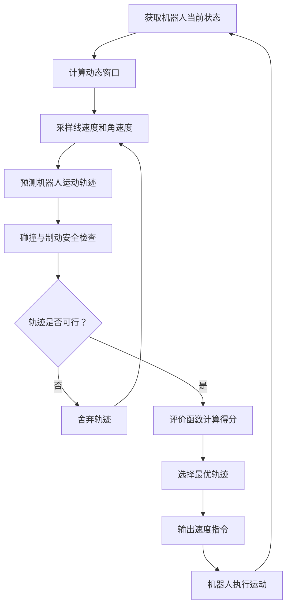
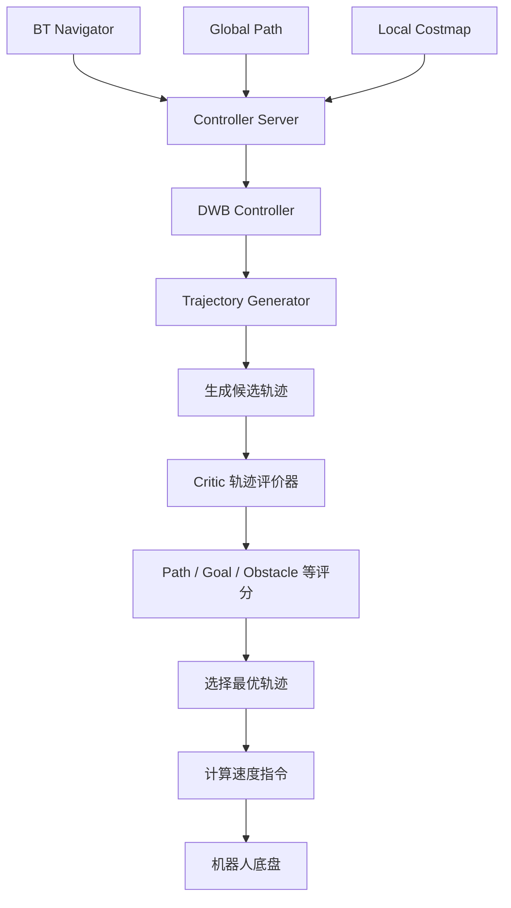

# ROS 2 路径规划学习：DWA 动态窗口法与 Nav2 DWB 局部控制器

## 一、前言

在移动机器人自主导航过程中，全局路径规划负责确定机器人从起点到目标点的大致路线，而局部路径规划则需要根据机器人当前的运动状态和周围环境，实时调整运动方向和速度。

例如，机器人已经通过 A* 算法获得了一条全局路径，但在实际运动过程中，前方可能突然出现障碍物，或者机器人与原定路径产生偏差。

此时，仅仅拥有一条全局路径是不够的，机器人还需要一种能够实时分析周围环境、预测自身运动并选择合适速度的局部规划方法。

DWA（Dynamic Window Approach，动态窗口法）就是一种经典的局部运动规划算法。

它的核心思想是：

**在机器人当前允许的速度范围内，采样不同的线速度和角速度，预测机器人未来的运动轨迹，再通过评价函数选择一组相对合适的速度指令。**

在 ROS 2 的 Nav2 导航框架中，还提供了 DWB（Dynamic Window Based）局部控制器插件。

DWB 基于动态窗口类方法的思想，通过轨迹生成器（Generator）和轨迹评价器（Critic）实现局部轨迹规划与控制。

本篇文章将从 DWA 的基本原理出发，逐步理解其数学模型、速度约束、轨迹评价机制以及存在的问题，最后结合 Nav2 理解 DWB 的工作方式。

---

## 二、DWA 动态窗口法的基本原理

### 2.1 什么是 DWA？

DWA 是一种基于机器人运动学模型的局部路径规划算法。

与 A* 直接在地图栅格中搜索路径不同，DWA 不会直接搜索一条从起点到终点的完整路线，而是从机器人当前能够执行的速度出发，预测不同速度对应的运动轨迹。

例如，机器人当前正在向前移动，周围存在障碍物。

它可以考虑多种运动方案：

- 保持当前速度继续前进。
- 降低线速度。
- 向左转弯。
- 向右转弯。
- 停止运动。

DWA 会对这些运动方案进行采样，预测机器人在未来一段时间内可能经过的位置，然后根据目标方向、障碍物距离和运动速度等因素评价这些轨迹。

最终选择一组相对合适的速度指令。

### 2.2 DWA 的整体工作流程

DWA 的主要工作过程可以分为以下几个步骤：

1. 获取机器人当前的位置、姿态和速度。
2. 根据机器人最大速度、最小速度和加速度限制，确定动态窗口。
3. 在允许的速度范围内采样不同的线速度和角速度。
4. 根据机器人运动学模型预测每组速度对应的运动轨迹。
5. 检查轨迹是否会发生碰撞，以及是否满足制动安全条件。
6. 使用评价函数对可行轨迹进行评分。
7. 选择评价结果较好的速度组合。
8. 发布速度指令，机器人执行运动。
9. 在下一控制周期重新获取状态并计算。

整体流程：



DWA 最重要的特点是：

**它不是直接选择一条路径，而是通过速度采样、轨迹预测和评价函数，选择当前时刻最合适的运动指令。**

### 2.3 速度空间

DWA 主要考虑两种速度：

- 线速度 \(v\)：控制机器人前进或后退的速度。
- 角速度 \(\omega\)：控制机器人旋转的速度。

因此，可以将机器人的运动状态表示为：

\[
(v,\omega)
\]

例如：

| 线速度 \(v\) | 角速度 \(\omega\) | 运动状态 |
|---|---|---|
| 正值 | 0 | 直线前进 |
| 0 | 正值 | 原地向左旋转 |
| 0 | 负值 | 原地向右旋转 |
| 正值 | 正值 | 前进并向左转弯 |
| 正值 | 负值 | 前进并向右转弯 |
| 0 | 0 | 停止 |

DWA 将这些速度组合看作一个二维速度空间。

算法需要在这个空间中寻找机器人当前能够执行、同时又比较安全和合理的速度组合。

---

## 三、DWA 的数学原理与核心机制

### 3.1 机器人运动学模型

DWA 需要根据线速度和角速度预测机器人未来的位置。

对于常见的二维差速移动机器人，可以使用以下运动学模型：

\[
\dot{x}=v\cos\theta
\]

\[
\dot{y}=v\sin\theta
\]

\[
\dot{\theta}=\omega
\]

其中：

- \(x\)：机器人在地图坐标系中的横向位置。
- \(y\)：机器人在地图坐标系中的纵向位置。
- \(\theta\)：机器人当前朝向角度。
- \(v\)：线速度。
- \(\omega\)：角速度。

这三个公式描述了机器人在不同速度指令下的位置和姿态变化。

例如：

当机器人保持一定线速度，并且角速度为 0 时，机器人沿直线前进。

当角速度不为 0 时，机器人会产生旋转运动，轨迹也会发生弯曲。

DWA 正是利用这个运动学模型，预测不同速度组合下机器人未来可能经过的位置。

### 3.2 动态窗口（Dynamic Window）

动态窗口是 DWA 最核心的部分之一。

机器人并不是想要什么速度就能立即达到什么速度。

它受到自身最大速度、最小速度以及加速度能力的限制。

例如：

机器人当前线速度为 0.2 m/s，最大加速度为 0.5 m/s²。

如果控制周期为 0.1 s，那么机器人在下一个周期内能够达到的线速度范围就受到加速度约束。

因此，DWA 需要同时考虑三个速度范围：

**1. 机器人自身速度限制**

由机器人底盘决定：

\[
V_s=
[v_{min},v_{max}]
\times
[\omega_{min},\omega_{max}]
\]

**2. 加速度约束**

机器人不能瞬间改变速度，需要考虑当前速度和加速度限制。

\[
V_a=
[v-a_v\Delta t,\ v+a_v\Delta t]
\]

角速度也有相应的加速度约束。

**3. 制动安全约束**

机器人需要保证在遇到障碍物时，能够及时减速并停止。

综合考虑这些条件，可以得到动态窗口中的可行速度集合：

\[
V_r=V_s\cap V_a\cap V_d
\]

其中：

- \(V_s\)：机器人自身速度限制。
- \(V_a\)：加速度限制。
- \(V_d\)：制动安全限制。
- \(V_r\)：最终允许采样的速度范围。

这意味着 DWA 不会随意采样所有速度，而是只在当前能够执行并且满足安全要求的速度范围内进行搜索。

### 3.3 制动距离与安全约束

机器人在运动过程中，即使发现前方存在障碍物，也不能保证立即停止。

因为机器人需要一定时间进行减速。

根据基础运动学公式，制动距离可以表示为：

\[
d_b=\frac{v^2}{2a_b}
\]

其中：

- \(d_b\)：制动距离。
- \(v\)：当前运动速度。
- \(a_b\)：制动减速度的大小。

例如：

假设机器人当前速度为：

\[
v=0.5\ m/s
\]

最大制动减速度为：

\[
a_b=0.5\ m/s^2
\]

那么理论制动距离为：

\[
d_b=\frac{0.5^2}{2\times0.5}
=0.25\ m
\]

也就是说，在理想的匀减速条件下，机器人至少需要 0.25 m 的距离才能停止。

因此，如果某条候选轨迹距离障碍物过近，就可能不满足安全制动条件，需要将其排除。

实际机器人还需要考虑传感器延迟、控制周期、底盘响应和安全裕量，因此不能直接把理论制动距离当成实际安全距离。

### 3.4 轨迹预测

在确定允许的速度范围后，DWA 会对不同的线速度和角速度进行采样。

例如：

```text
候选速度组合：

(v1, ω1)
(v2, ω2)
(v3, ω3)
(v4, ω4)
(v5, ω5)
```

每一组速度都可以通过运动学模型预测出一条未来轨迹。

<figure>
</figure>

可以将这些轨迹理解为机器人在不同控制指令下，未来一段时间内可能走过的路线。

有的轨迹可能直接接近目标点，有的可能会碰撞障碍物，还有的虽然安全，但是绕行距离较长。

因此，DWA 需要进一步对这些轨迹进行评价。

### 3.5 评价函数（Evaluation Function）

DWA 会根据不同的评价指标，对每条候选轨迹进行评分。

经典 DWA 中常见的评价因素包括：

**Heading：目标方向评价**

判断机器人当前运动方向是否朝向目标。

方向越接近目标方向，通常评价越好。

**Clearance：障碍物距离评价**

判断机器人预测轨迹与障碍物之间的距离。

距离越大，通常安全性越高。

**Velocity：速度评价**

判断机器人当前运动速度是否符合期望。

在安全条件满足的情况下，通常希望机器人保持较高的运动效率。

经典 DWA 可以用以下形式表示综合评价：

\[
G(v,\omega)=
\alpha\cdot Heading+
\beta\cdot Clearance+
\gamma\cdot Velocity
\]

其中：

- \(\alpha\)：方向评价权重。
- \(\beta\)：障碍物距离评价权重。
- \(\gamma\)：速度评价权重。

权重越大，表示对应评价因素对最终选择的影响越大。

需要注意，不同实现中的评分方向和归一化方式可能不同。这里的公式表示经典 DWA 的一种概念性评价形式。

最终，算法根据综合评价结果，选择相对合适的速度组合。

### 3.6 滚动规划机制

DWA 并不是一次性规划完机器人接下来所有运动。

它采用的是滚动规划（Receding Horizon）的思想。

简单来说：

1. 获取当前机器人状态。
2. 预测未来一段时间的运动轨迹。
3. 选择当前最合适的速度。
4. 只执行当前控制周期的速度指令。
5. 重新获取传感器和机器人状态。
6. 再次进行轨迹预测和速度选择。

这样，机器人就能够根据环境变化不断调整运动方向。

例如，机器人正在向目标点前进，突然有一个动态障碍物出现在前方。

下一次规划时，DWA 就可以根据更新后的障碍物信息重新计算候选轨迹，选择其他运动方案。

这也是局部规划能够适应动态环境的重要原因。

---

## 四、DWA 的局限性与改进方向

DWA 虽然能够根据实时环境调整机器人运动，但并不是在所有情况下都能得到理想的结果。

### 4.1 局部最优问题

DWA 主要关注当前局部环境和短时间内的运动结果。

因此，有时会选择一条当前看来比较合理，但从整体来看并不是最佳的运动方案。

例如：

机器人前方有一个 U 型障碍物。

机器人可能不断尝试绕过障碍物，但由于局部视野和评价函数的限制，可能无法找到正确的脱离方向。

这就是局部规划容易遇到的问题之一。

### 4.2 振荡问题

当机器人位于两个障碍物之间，或者全局路径与局部避障要求相互冲突时，机器人可能不断改变左右转向。

例如：

```text
第一次规划：向左转
第二次规划：向右转
第三次规划：向左转
第四次规划：向右转
```

机器人在局部区域反复调整方向，导致运动不稳定。

这类问题通常与轨迹评分、权重设置、路径跟踪要求和环境结构有关。

### 4.3 狭窄通道问题

在狭窄通道中，机器人可选择的运动空间比较有限。

如果机器人宽度较大，或者障碍物之间的距离较小，很多候选轨迹都会被判定为不安全。

最终可能没有足够的可行轨迹，导致机器人无法正常前进。

### 4.4 死胡同问题

DWA 主要进行局部范围内的轨迹预测。

如果机器人进入一个死胡同，可能需要后退或者绕行才能脱离。

但是，仅仅依靠当前局部轨迹评价，不一定能够及时判断应该采取怎样的全局调整策略。

因此，通常需要结合全局路径规划、重新规划以及恢复行为来处理。

### 4.5 参数调节问题

DWA 的效果与多个参数有关，例如：

- 线速度和角速度的最大值。
- 线速度和角速度的加速度限制。
- 速度采样数量。
- 轨迹预测时间。
- 制动减速度。
- 评价函数的权重。

参数设置不合理，可能导致机器人运动过慢、转弯不及时、避障不稳定或者频繁振荡。

因此，在实际使用中，需要根据机器人底盘、传感器和环境进行合理调整。

### 4.6 DWA 的改进方向

针对以上问题，可以从以下几个方面进行改进：

| 问题 | 改进方向 |
|---|---|
| 局部最优 | 结合全局路径信息，引入重新规划机制 |
| 振荡问题 | 调整评价函数和路径跟踪权重 |
| 狭窄通道 | 优化速度采样和机器人运动约束 |
| 动态障碍物 | 提高环境更新频率，结合动态障碍物预测 |
| 参数调节困难 | 根据环境和机器人状态进行参数优化 |
| 陷入死胡同 | 结合全局规划和 Recovery 恢复行为 |

可以看出，DWA 的核心优势是实时性和局部运动调整能力，但要完成复杂环境中的自主导航，通常还需要其他模块配合。

---

## 五、Nav2 中的 DWB 局部控制器

### 5.1 DWB 是什么？

DWB（Dynamic Window Based）是 ROS 2 Nav2 中提供的一种局部控制器插件。

它基于动态窗口类方法的思想，通过生成候选运动轨迹，再利用不同的评价器对轨迹进行评分，选择合适的运动指令。

在 Nav2 整体架构中，DWB 位于 Controller Server（控制器服务器）内部。

Controller Server 负责管理局部控制器插件，而 DWB 负责具体的轨迹生成、评价和速度计算。

它们之间的关系：



DWB 的核心可以概括为：

**Generator 负责生成候选轨迹，Critic 负责评价候选轨迹。**

### 5.2 Generator：轨迹生成器

Generator 是 DWB 中负责生成候选运动轨迹的部分。

它根据机器人当前速度、运动学限制和采样参数，生成多条可能的运动轨迹。

例如：

```text
候选轨迹：

Trajectory 1：直线前进
Trajectory 2：向左转弯
Trajectory 3：向右转弯
Trajectory 4：减速前进
Trajectory 5：原地旋转
```

不同轨迹代表机器人在不同控制指令下未来可能产生的运动结果。

Nav2 DWB 中常见的轨迹生成器是：

`StandardTrajectoryGenerator`

它根据配置的速度采样和运动模型生成候选轨迹。

### 5.3 Critic：轨迹评价器

如果只有 Generator，系统虽然能够生成很多候选轨迹，但是并不知道哪一条更适合当前环境。

因此，DWB 还需要 Critic（轨迹评价器）。

Critic 负责根据不同的评价标准，对候选轨迹进行评分。

例如：

- 这条轨迹是否接近全局路径？
- 这条轨迹是否朝向目标？
- 这条轨迹是否会碰撞障碍物？
- 这条轨迹是否满足机器人运动要求？

每个 Critic 负责评价一个或多个方面。

多个评价器可以共同参与轨迹评分。

在常见配置中，可以将不同评价器的代价乘以对应权重，再组合成总评分：

\[
Score(T)=
\sum_{i=1}^{n}w_i\cdot C_i(T)
\]

其中：

- \(T\)：候选轨迹。
- \(C_i(T)\)：第 \(i\) 个评价器对轨迹的评分。
- \(w_i\)：对应评价器的权重。

在 DWB 常见的评分机制中，通常是总 cost 越低越好。

最终选择总评分较低的可行轨迹，并根据该轨迹生成运动指令。

### 5.4 Generator 与 Critic 的配合

可以通过一个简单例子理解它们之间的关系。

假设机器人前方有一个障碍物，同时目标点位于障碍物后方。

Generator 生成了三条候选轨迹：

| 候选轨迹 | 运动方式 |
|---|---|
| 轨迹 A | 直接向前 |
| 轨迹 B | 向左绕行 |
| 轨迹 C | 向右绕行 |

接下来，Critic 对这些轨迹进行评价。

| 评价项目 | 轨迹 A | 轨迹 B | 轨迹 C |
|---|---|---|---|
| 路径接近程度 | 好 | 较好 | 一般 |
| 障碍物安全性 | 差 | 好 | 好 |
| 目标方向 | 好 | 较好 | 一般 |
| 综合代价 | 高 | 低 | 中 |

这里假设轨迹 A 距离障碍物太近，可能被判定为不可行。

轨迹 B 和 C 都可以通过安全性检查，但轨迹 B 更符合全局路径和目标方向。

因此，DWB 可能选择轨迹 B。

需要注意，上表是为了理解 Generator 和 Critic 的工作关系而构造的示例，并不代表 DWB 固定使用这几个评价指标或固定的评分结果。

### 5.5 DWB 与 DWA 的区别

DWA 和 DWB 有一定联系，但不能简单地认为它们完全相同。

DWA 是经典的动态窗口法算法，DWB 则是 Nav2 中基于动态窗口思想实现的局部控制器插件。

| 对比项目 | DWA | DWB |
|---|---|---|
| 类型 | 经典局部规划算法 | Nav2 局部控制器插件 |
| 核心思想 | 速度采样、轨迹预测和评价 | 轨迹生成和多评价器评分 |
| 速度采样 | 在动态窗口内采样 | 由轨迹生成器根据配置生成候选轨迹 |
| 轨迹评价 | 经典评价函数 | 可配置的多个 Critic |
| 扩展方式 | 根据算法实现进行修改 | 可配置 Generator 和 Critic 插件 |
| 应用环境 | 各类机器人系统 | ROS 2 Nav2 |

它们的共同点是：

1. 都属于局部运动规划与控制思路。
2. 都会考虑机器人当前的运动状态。
3. 都会预测候选运动轨迹。
4. 都需要根据环境和目标信息选择运动方案。
5. 都可以通过速度指令控制机器人运动。

它们的区别主要体现在软件架构和具体实现方式上。

DWB 通过插件机制提供了更加模块化、可配置的轨迹生成和评价方式。

---

## 六、DWA 与 DWB 的学习总结

通过本阶段的学习，对 DWA 动态窗口法和 Nav2 中的 DWB 局部控制器有了更加完整的认识。

**DWA 方面：**

理解了动态窗口法的基本思想，掌握了速度空间、动态窗口、轨迹预测和评价函数等核心概念。

进一步学习了机器人运动学模型，理解了线速度、角速度如何影响机器人未来的运动轨迹。

通过速度约束和制动距离公式，理解了 DWA 为什么不能随意选择速度，以及如何在保证安全的前提下选择合适的运动指令。

同时认识到 DWA 在实际应用中可能出现的局部最优、振荡、狭窄通道和死胡同等问题。

**DWB 方面：**

理解了 DWB 在 Nav2 整体导航架构中的位置，认识到它是 Controller Server 中的局部控制器插件。

重点学习了 Generator 和 Critic 两个核心组成部分：

- Generator：负责生成候选运动轨迹。
- Critic：负责评价候选运动轨迹。

理解了多个评价器如何从路径接近程度、目标方向和障碍物安全性等角度评价轨迹，并通过综合评分选择合适的运动方案。

通过对比 DWA 和 DWB，进一步理解了经典路径规划算法与 ROS 2 导航框架中具体控制器插件之间的联系。

### 最后总结

DWA 的核心是：

**在动态窗口内采样速度，预测运动轨迹，通过评价函数选择合适的速度指令。**

DWB 的核心是：

**通过 Generator 生成候选轨迹，再由 Critic 对轨迹进行评价，选择合适的运动方案。**

在机器人自主导航系统中，全局规划负责提供整体路线，局部控制器负责根据实时环境调整运动指令。

DWA 和 DWB 都体现了局部规划中一个重要的思想：

机器人不仅要知道应该去哪里，还需要根据当前环境判断下一步应该如何运动。

从之前学习的 APF、A*，到现在的 DWA 和 DWB，逐渐建立起了对不同路径规划算法的理解，也进一步认识到这些算法如何在 ROS 2 Nav2 导航框架中发挥作用。

**最终目标：能够理解不同路径规划算法的核心原理，掌握全局规划与局部控制的区别，并能够结合 ROS 2、Nav2 和 Gazebo 仿真环境，分析机器人自主导航过程中各个模块的工作方式。**

---

## 参考资料

- [ROS 2 Navigation2 官方文档](https://docs.nav2.org/)
- [Nav2 DWB Controller 官方文档](https://docs.nav2.org/configuration/packages/configuring-dwb-controller.html)
- [Nav2 Controller Server 官方文档](https://docs.nav2.org/configuration/packages/configuring-controller-server.html)
- [Dynamic Window Approach 相关论文：The Dynamic Window Approach to Collision Avoidance](https://doi.org/10.1109/100.580977)
