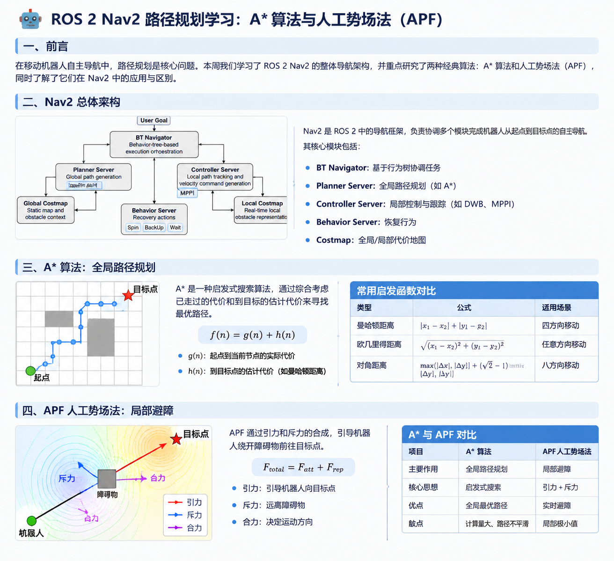
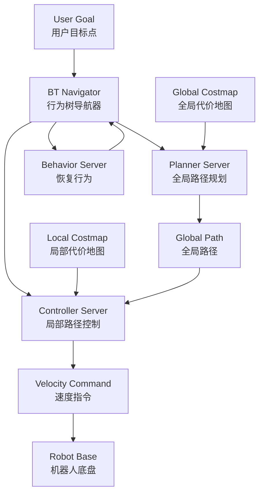
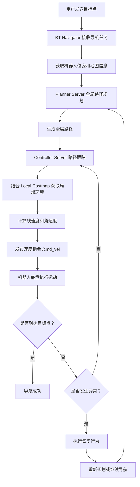
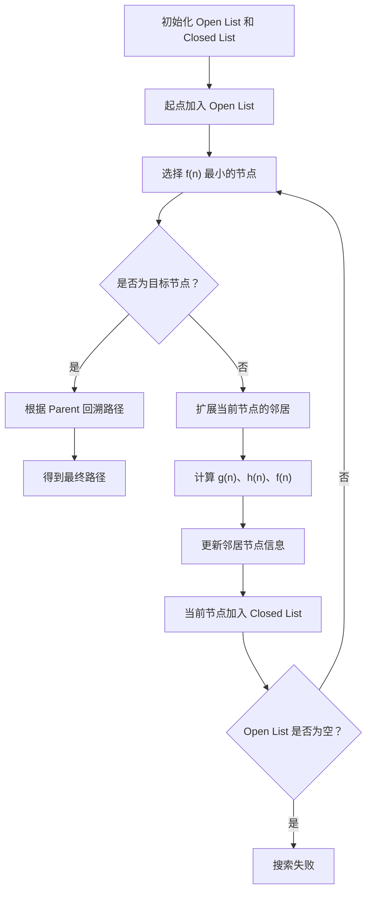
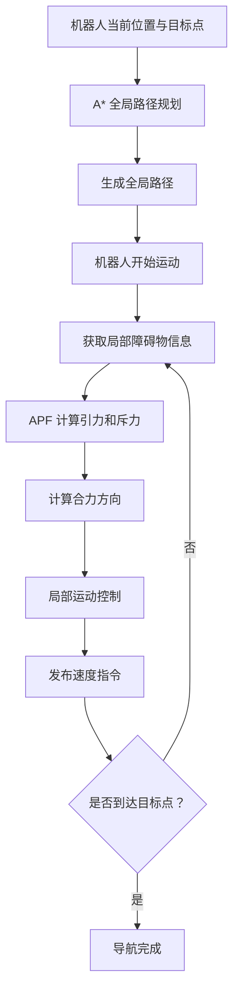

# ROS 2 Nav2 路径规划学习：A*算法与人工势场法（APF）

## 一、前言

在移动机器人自主导航过程中，路径规划是一个非常重要的环节。

当我们给机器人指定一个目标位置时，机器人不仅需要知道目标在哪里，还需要解决如何到达目标点、如何绕开障碍物，以及如何根据周围环境实时调整运动方向等问题。

本周主要围绕 ROS 2 中的 Nav2 导航框架展开学习，重点研究了两种经典路径规划算法：

- **A*（A-Star）算法**：一种基于启发式搜索的全局路径规划算法。
- **APF（Artificial Potential Field）人工势场法**：一种基于引力和斥力合成的局部避障方法。

在学习具体算法之前，首先需要理解 Nav2 的整体架构，明确全局路径规划、局部控制、代价地图以及行为树等模块之间的关系。

---

## 二、Nav2 导航框架总体架构

### 2.1 Nav2 是什么？

Nav2（Navigation2）是 ROS 2 中用于移动机器人自主导航的导航框架。

它并不是某一种具体的路径规划算法，而是将路径规划、运动控制、环境感知、行为决策和故障恢复等功能组织起来的一套完整导航系统。

例如，当用户向机器人发送一个目标点时，Nav2 需要协调多个模块完成以下工作：

1. 获取机器人的当前位置和目标位置。
2. 根据地图信息进行全局路径规划。
3. 根据周围环境进行局部路径跟踪和避障。
4. 计算机器人需要执行的线速度和角速度。
5. 将速度指令发送给机器人底盘。
6. 如果导航过程中发生异常，执行相应的恢复行为。

因此，可以将 Nav2 理解为一个负责组织和协调各种导航算法的框架。

### 2.2 Nav2 整体架构

Nav2 的核心组成部分包括：

- BT Navigator：行为树导航器。
- Planner Server：全局路径规划服务器。
- Controller Server：局部控制器服务器。
- Behavior Server：行为服务器。
- Global Costmap：全局代价地图。
- Local Costmap：局部代价地图。

各模块之间的关系如下：

### 2.3 核心模块详解

#### 1. BT Navigator（行为树导航器）

BT Navigator 是 Nav2 的导航任务协调中心。

它通过行为树（Behavior Tree，BT）组织和管理整个导航过程，决定什么时候进行路径规划、什么时候执行路径跟踪，以及什么时候触发恢复行为。

例如：

- 接收到目标点后，启动全局路径规划。
- 路径规划成功后，执行路径跟踪。
- 如果机器人无法正常前进，尝试执行恢复行为。
- 如果环境发生变化，可以重新规划路径。

可以将 BT Navigator 理解为整个导航系统的调度中心。

#### 2. Planner Server（全局路径规划服务器）

Planner Server 负责生成从机器人当前位置到目标位置的全局路径。

它会根据 Global Costmap 提供的环境信息，调用对应的全局规划算法。

常见的规划器包括：

- NavFn：支持 Dijkstra 和 A* 搜索模式。
- Smac Planner：支持不同类型的搜索规划。
- Theta*：能够生成具有视线连接特点的路径。

本周学习的 A* 算法就属于全局路径规划的典型算法。

它主要解决的问题是：

**在已知地图中，如何从起点搜索到目标点，并找到一条代价较低的可行路径。**

#### 3. Controller Server（控制器服务器）

Controller Server 负责根据全局路径和当前局部环境，计算机器人下一步应该如何运动。

它主要完成：

- 全局路径跟踪。
- 局部障碍物避让。
- 线速度和角速度计算。
- 速度指令生成。

常见的控制器包括 DWB 和 MPPI。

需要注意，全局规划器负责生成路径，而控制器负责让机器人实际按照路径运动，两者的职责并不相同。

#### 4. Behavior Server（行为服务器）

Behavior Server 主要负责导航过程中的恢复行为。

当机器人遇到障碍物或者无法继续前进时，可以执行相应的恢复动作。

常见行为包括：

| 行为 | 作用 |
|---|---|
| Spin | 原地旋转，尝试重新观察周围环境 |
| BackUp | 向后移动一段距离 |
| Wait | 等待一段时间 |

这些行为可以帮助机器人从一些临时的导航异常中恢复。

### 2.4 Costmap（代价地图）

Costmap 是 Nav2 中非常重要的组成部分。

它将机器人周围的环境转换为带有代价值的栅格地图，不同位置具有不同的通行代价。

例如：

| 区域 | 代价含义 |
|---|---|
| 自由区域 | 代价较低，可以正常通行 |
| 障碍物附近 | 代价较高，需要尽量避开 |
| 障碍物区域 | 不允许正常通行 |
| 未知区域 | 根据配置决定是否允许通过 |

Nav2 中主要有两种代价地图。

**Global Costmap（全局代价地图）**

- 主要服务于全局路径规划。
- 通常结合静态地图使用。
- 为全局规划器提供整体环境信息。

**Local Costmap（局部代价地图）**

- 主要服务于局部控制器。
- 可以根据激光雷达、深度相机等传感器数据更新。
- 主要反映机器人附近实时变化的障碍物情况。

简单来说，全局代价地图关注整体环境，局部代价地图关注机器人附近的实时环境。

### 2.5 Nav2 整体工作流程

当用户发送一个目标点时，Nav2 的基本导航流程如下：

通过整个架构可以看出，Nav2 并不是单纯依赖某一种算法，而是通过多个模块相互配合，实现机器人从目标接收、路径规划到运动控制的完整导航过程。

---

## 三、A* 算法：全局路径规划

### 3.1 A* 算法基本原理

A*（A-Star）是一种经典的启发式搜索算法，广泛应用于机器人路径规划、游戏寻路和地图搜索等场景。

它的主要作用是在已知地图中，寻找从起点到目标点的一条代价较低的路径。

例如，在一个栅格地图中，机器人位于左下角，目标点位于右上角，中间存在一些障碍物。

A* 算法需要不断搜索和判断周围的节点，避开障碍物，最终找到一条可行路径。

与盲目搜索不同，A* 不仅考虑已经走过的距离，还会估计当前位置距离目标点还有多远。

### 3.2 核心公式

A* 算法最核心的公式为：

\[
\boxed{f(n)=g(n)+h(n)}
\]

其中：

| 符号 | 含义 |
|---|---|
| \(f(n)\) | 节点 n 的综合评估代价 |
| \(g(n)\) | 从起点到当前节点的实际代价 |
| \(h(n)\) | 从当前节点到目标点的预估代价 |

**1. g(n)：实际代价**

g(n) 表示从起点移动到当前节点已经产生的累计代价。

例如，机器人从起点开始移动，已经经过了 5 个单位的距离，那么：

\[
g(n)=5
\]

**2. h(n)：启发式估计代价**

h(n) 表示从当前节点到目标点的预估代价。

例如，在只能上下左右移动的栅格地图中，可以使用曼哈顿距离：

\[
h(n)=|x_n-x_g|+|y_n-y_g|
\]

假设当前节点坐标为 (2,3)，目标节点坐标为 (7,8)，那么：

\[
h(n)=|2-7|+|3-8|=10
\]

这里的 10 表示按照曼哈顿距离估计，还需要移动 10 个单位。

需要注意，h(n) 是估计值，并不代表真实剩余路径长度。

为了保证标准 A* 的最优性，启发函数通常需要满足不高估真实最低剩余代价的条件：

\[
h(n)\leq h^*(n)
\]

其中 \(h^*(n)\) 表示从当前节点到目标点的真实最低代价。

**3. f(n)：综合评估代价**

将已经走过的实际代价和剩余路程的预估代价相加：

\[
f(n)=g(n)+h(n)
\]

例如：

| 节点 | g(n) | h(n) | f(n) |
|---|---:|---:|---:|
| A | 3 | 8 | 11 |
| B | 5 | 4 | 9 |
| C | 2 | 10 | 12 |

此时 B 节点的 f(n) 最小，因此算法优先扩展 B 节点。

这就是 A* 算法的核心思想：

**优先选择综合评估代价最小的节点进行搜索。**

### 3.3 A* 算法执行流程

A* 算法通常维护两个集合：

- Open List：待探索节点集合。
- Closed List：已经探索过的节点集合。

具体执行过程：

1. 将起点放入 Open List。
2. 从 Open List 中选择 f(n) 最小的节点。
3. 判断当前节点是否为目标节点。
4. 如果不是目标节点，则检查周围的邻居节点。
5. 计算邻居节点的 g(n)、h(n) 和 f(n)。
6. 如果找到更优的到达方式，则更新节点代价和父节点。
7. 将当前节点加入 Closed List。
8. 重复以上过程，直到找到目标节点或者 Open List 为空。
9. 找到目标点后，通过父节点信息反向回溯，得到完整路径。

A* 的关键不只是计算节点代价，还需要不断更新节点的父节点信息，最终通过路径回溯得到从起点到目标点的完整路线。

### 3.4 常见启发函数

不同的移动方式需要选择不同的启发函数。

**曼哈顿距离**

适用于只能上下左右移动的栅格地图。

\[
h=|x_1-x_2|+|y_1-y_2|
\]

**欧几里得距离**

适用于允许任意方向移动的情况。

\[
h=\sqrt{(x_1-x_2)^2+(y_1-y_2)^2}
\]

**对角距离**

适用于允许八方向移动，并且直线移动和对角移动代价不同的栅格地图。

启发函数的选择会影响 A* 的搜索效率以及最优性保证。

### 3.5 A* 的优缺点

| 优点 | 缺点 |
|---|---|
| 能够找到代价较低的路径 | 大地图中搜索量可能较大 |
| 利用启发函数提高搜索效率 | 需要维护搜索节点集合 |
| 能够结合栅格地图使用 | 内存占用可能较高 |
| 原理清晰，应用广泛 | 生成的路径可能不够平滑 |

A* 主要负责全局路径搜索，得到的通常是栅格路径，并不意味着机器人可以直接按照这条路径平滑运动。

在实际机器人导航中，还需要结合路径平滑、局部控制和机器人运动学约束。

---

## 四、APF 人工势场法：局部避障

### 4.1 APF 基本原理

人工势场法（Artificial Potential Field，APF）是一种经典的机器人局部避障方法。

它的核心思想是：

将机器人周围的环境模拟成一个虚拟势场，目标点对机器人产生引力，障碍物对机器人产生斥力，机器人根据两种力的合力方向进行运动。

可以将机器人想象成一个小球：

- 目标点像一个吸引小球的磁铁。
- 障碍物像一个排斥小球的磁铁。
- 机器人同时受到引力和斥力的作用。
- 最终根据合力方向调整运动方向。

### 4.2 引力场（Attractive Potential Field）

引力场由目标点产生，主要作用是引导机器人朝目标点移动。

常见的二次型引力势能函数：

\[
U_{att}(q)=\frac{1}{2}k_{att}\rho^2(q,q_g)
\]

其中：

- \(U_{att}\)：引力势能。
- \(k_{att}\)：引力增益系数。
- \(q\)：机器人当前位置。
- \(q_g\)：目标点位置。
- \(\rho(q,q_g)\)：机器人当前位置到目标点的距离。

引力由势能的负梯度得到：

\[
F_{att}(q)=-\nabla U_{att}(q)
\]

对于二维空间：

\[
F_{att}=k_{att}(q_g-q)
\]

因此，引力方向始终指向目标点。

机器人距离目标点越远，引力通常越大；随着机器人逐渐接近目标点，引力逐渐减小。

### 4.3 斥力场（Repulsive Potential Field）

斥力场由障碍物产生，主要作用是让机器人远离障碍物。

机器人距离障碍物越近，通常受到的斥力越大。

常见的斥力势能函数：

\[
U_{rep}(q)=
\begin{cases}
\frac{1}{2}k_{rep}
\left(\frac{1}{\rho(q)}-\frac{1}{\rho_0}\right)^2,
& \rho(q)\leq \rho_0\\
0,& \rho(q)>\rho_0
\end{cases}
\]

其中：

- \(U_{rep}\)：斥力势能。
- \(k_{rep}\)：斥力增益系数。
- \(\rho(q)\)：机器人到最近障碍物的距离。
- \(\rho_0\)：障碍物影响范围。

当机器人距离障碍物超过影响范围时，斥力为零。

当机器人进入障碍物影响范围后，斥力开始产生，并且随着机器人接近障碍物而迅速增大。

这里需要区分两个概念：

- **势能**：描述机器人当前位置受到的势场能量。
- **斥力**：由势能的负梯度计算得到，表示机器人受到的排斥方向和大小。

势能本身并不是直接发布给机器人的速度指令，而是通过求梯度得到斥力。

### 4.4 引力与斥力的合成

APF 最核心的部分就是将引力和斥力进行合成。

总合力公式：

\[
\boxed{F_{total}=F_{att}+F_{rep}}
\]

其中：

- \(F_{total}\)：机器人受到的总合力。
- \(F_{att}\)：目标点产生的引力。
- \(F_{rep}\)：障碍物产生的斥力。

例如：

机器人前方存在一个障碍物，而目标点位于障碍物后方。

此时：

1. 引力指向目标点。
2. 斥力指向远离障碍物的方向。
3. 两种力通过向量相加得到总合力。
4. 机器人根据总合力方向调整运动方向。
5. 最终实现绕开障碍物并继续接近目标点。

需要注意，引力和斥力是向量，合力方向由两个向量共同决定，并不是简单比较两种力的大小。

### 4.5 APF 如何转化为机器人运动指令？

APF 计算得到的是一个合力向量，而不是直接得到 `/cmd_vel`。

在实际机器人中，需要将合力方向转换为期望运动方向，再结合机器人运动学模型和速度控制策略，计算实际的线速度和角速度。

基本过程：

1. 获取机器人当前位置。
2. 获取目标点位置。
3. 获取周围障碍物信息。
4. 计算目标点引力。
5. 计算障碍物斥力。
6. 将引力和斥力进行合成。
7. 根据合力方向计算机器人期望运动方向。
8. 根据运动控制策略计算线速度和角速度。
9. 发布速度指令。

在 ROS 2 中，可以将这个过程与以下话题联系起来：

| 话题 | 作用 |
|---|---|
| `/scan` | 接收激光雷达数据 |
| `/odom` | 获取机器人里程计信息 |
| `/cmd_vel` | 发布机器人速度指令 |

具体话题名称取决于机器人和 Nav2 的实际配置。

另外，合力大小并不一定直接等于机器人运动速度，实际速度还需要经过限幅、安全检查和控制策略处理。

### 4.6 APF 的局部极小值问题

虽然人工势场法原理简单，但是存在一个比较典型的问题：局部极小值（Local Minima）。

当机器人受到引力和斥力的共同作用时，如果两者恰好抵消：

\[
F_{total}=0
\]

此时机器人可能停留在当前位置。

但是这个位置不一定是目标点。

例如：

机器人需要通过一个 U 形障碍物到达障碍物另一侧的目标点。

机器人受到目标点引力和 U 形障碍物斥力的共同作用，可能被困在 U 形障碍物内部。

此时机器人虽然没有到达目标点，但是合力可能已经接近零，导致机器人无法继续前进。

APF 还存在其他问题：

| 问题 | 产生原因 |
|---|---|
| 局部极小值 | 引力和斥力相互抵消 |
| 振荡问题 | 多个障碍物的斥力导致方向反复变化 |
| 狭窄通道问题 | 两侧障碍物斥力过大 |
| U 形障碍物问题 | 机器人可能被困在局部区域 |

针对这些问题，可以引入全局路径规划、局部极小值检测、逃逸策略以及参数调整等方法进行改进。

---

## 五、A* 与 APF 的区别及应用

### 5.1 两种算法的区别

A* 和 APF 都可以应用于机器人路径规划，但是两者的基本思想和解决的问题不同。

| 对比项目 | A* 算法 | APF 人工势场法 |
|---|---|---|
| 算法类型 | 启发式搜索算法 | 基于势场的规划方法 |
| 主要用途 | 全局路径规划 | 局部避障 |
| 核心思想 | 计算节点综合代价 | 引力与斥力合成 |
| 核心公式 | \(f(n)=g(n)+h(n)\) | \(F=F_{att}+F_{rep}\) |
| 环境信息 | 通常使用已知地图 | 通常结合局部障碍物信息 |
| 输出结果 | 离散路径 | 合力方向或局部运动引导 |
| 主要问题 | 搜索量大、路径不平滑 | 局部极小值、振荡问题 |

### 5.2 A* 与 APF 如何结合？

在实际机器人导航中，可以让 A* 和 APF 分别负责不同的任务。

A* 负责从起点到目标点寻找全局路径，APF 根据机器人附近的障碍物信息进行局部避障。

例如：

机器人需要从房间 A 移动到房间 B。

首先，A* 根据地图搜索一条全局路径。

机器人开始沿着全局路径运动，当附近出现动态障碍物时，APF 根据目标方向产生引力，根据障碍物产生斥力，通过合力调整机器人的运动方向。

障碍物避开后，机器人继续朝着全局路径方向前进。

整体思路：

需要说明的是，这是一种 A* 与 APF 组合的算法设计思路，并不是 Nav2 默认就会自动采用的固定组合。

实际 Nav2 通常通过全局规划器和局部控制器插件完成对应功能。

### 5.3 Nav2 中其他相关算法与技术

除了本次重点学习的 A* 和 APF，Nav2 还涉及一些其他重要技术。

**DWA（Dynamic Window Approach）**

动态窗口法是一种局部运动规划算法。

它通过在机器人当前可行的速度空间中采样不同的线速度和角速度，预测机器人未来的运动轨迹，再根据评价函数选择合适的速度组合。

**DWB（Dynamic Window Based）**

DWB 是 Nav2 中常用的局部控制器插件。

它通过多个评价器对候选轨迹进行评分，选择合适的运动轨迹和速度指令。

**TF 坐标变换**

机器人导航过程中涉及多个坐标系，例如：

- `map`：地图坐标系。
- `odom`：里程计坐标系。
- `base_link`：机器人本体坐标系。
- `laser`：激光雷达坐标系。

TF 负责管理这些坐标系之间的变换关系，为定位、路径规划和障碍物检测提供坐标基础。

---

## 六、本周学习总结

本周主要围绕 ROS 2 Nav2 导航框架和经典路径规划算法展开学习。

**Nav2 总体架构方面：**

理解了 Nav2 并不是单一的路径规划算法，而是由多个功能模块组成的完整导航框架。

重点了解了 BT Navigator、Planner Server、Controller Server、Behavior Server，以及 Global Costmap 和 Local Costmap 的作用和相互关系。

**A* 算法方面：**

掌握了 A* 算法的基本搜索思想，理解了 Open List、Closed List，以及 g(n)、h(n)、f(n) 三个核心参数，了解了曼哈顿距离和欧几里得距离等启发函数。

**APF 人工势场法方面：**

理解了目标点引力、障碍物斥力以及合力的计算过程，掌握了势能和斥力之间的关系，同时了解了局部极小值、振荡和狭窄通道等典型问题。

通过本周的学习，对全局路径规划和局部避障有了更加清晰的认识：

- A* 主要解决机器人整体应该怎么走的问题。
- APF 主要解决机器人附近如何根据障碍物调整运动方向的问题。
- Nav2 则负责组织不同的规划、控制和行为模块，实现完整的机器人自主导航。

后续将继续学习 DWA、DWB 等局部规划与控制方法，并结合 ROS 2 和 Gazebo 仿真环境，进一步理解不同算法在实际机器人导航中的应用。
