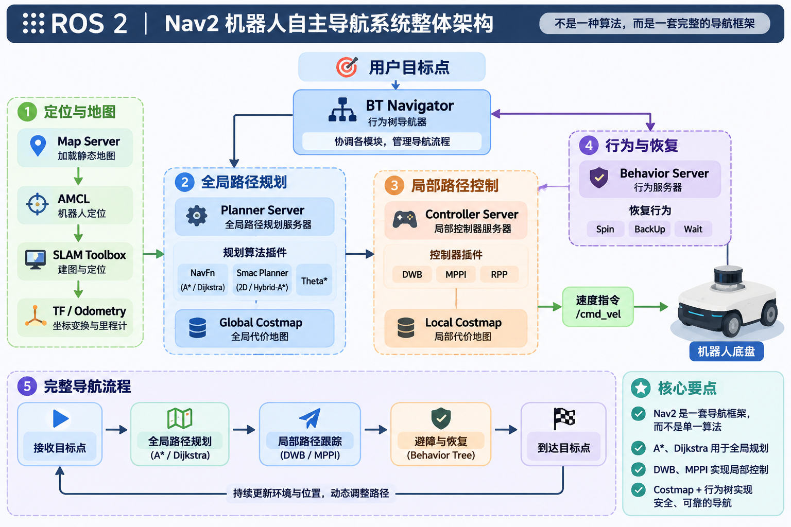
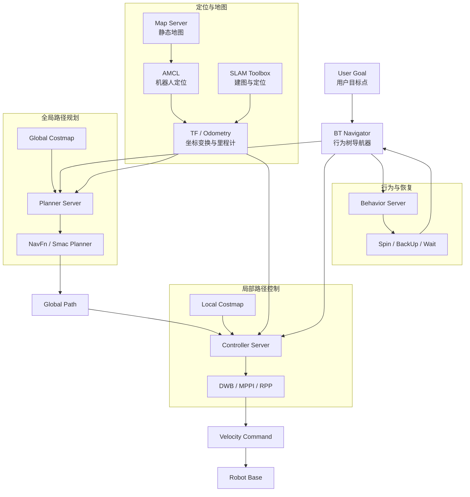
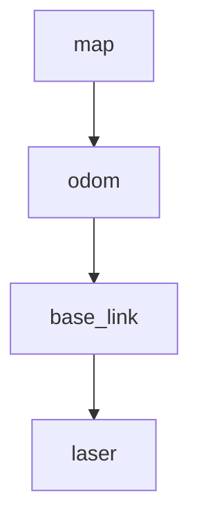
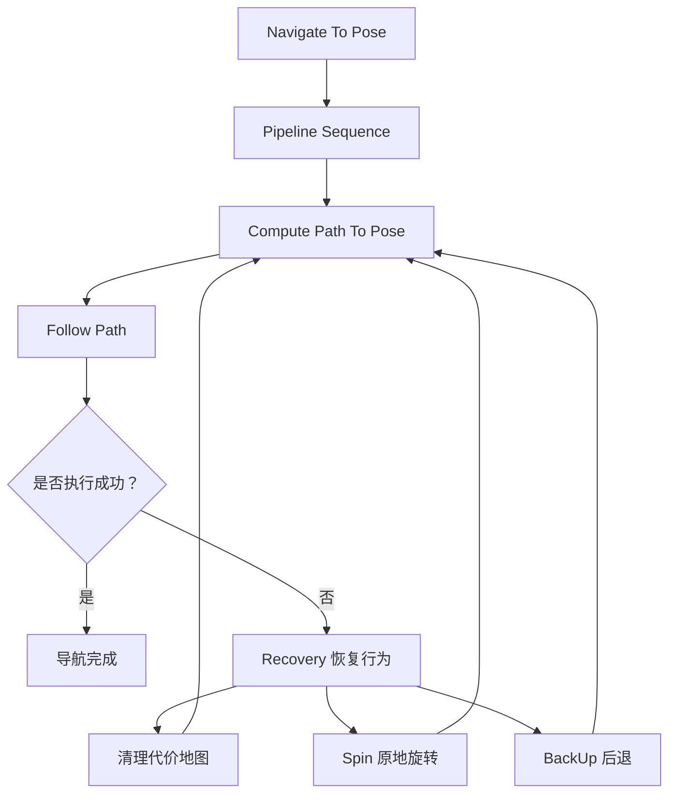
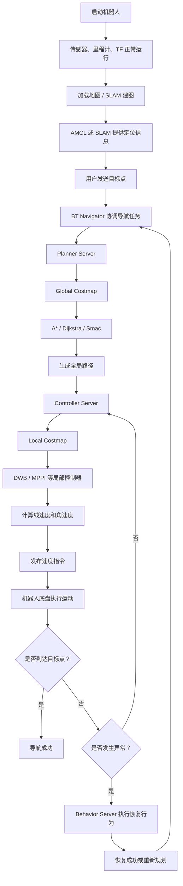

# ROS 2 Nav2 深入学习：机器人自主导航系统整体架构与核心算法

## 一、前言

在移动机器人自主导航过程中，路径规划只是整个导航系统中的一个环节。

当用户给机器人指定一个目标位置时，机器人需要完成一系列工作：

1. 获取周围环境信息，建立地图。
2. 确定自己在地图中的位置。
3. 根据当前位置和目标位置规划一条可行路径。
4. 根据周围障碍物信息调整运动方向。
5. 将计算得到的速度指令发送给机器人底盘。
6. 在遇到障碍物或导航异常时，执行相应的恢复行为。

这些功能涉及定位、地图、路径规划、局部控制、环境感知和行为决策等多个方面。

ROS 2 中的 Nav2（Navigation2）正是为了解决这些问题而设计的一套完整机器人导航框架。

此前已经学习过 A*、人工势场法（APF）、DWA、DWB 等路径规划与控制算法。本阶段将从整体系统的角度出发，进一步理解这些算法在 Nav2 中所处的位置，以及它们如何相互配合完成机器人自主导航。

首先需要明确一个核心概念：

**Nav2 不是单独的一种路径规划算法，而是一套将定位、全局路径规划、局部控制、代价地图、行为树和恢复行为等功能组合起来的机器人导航框架。**

---

## 二、Nav2 整体系统架构


### 2.1 Nav2 是什么？

Nav2（Navigation2）是 ROS 2 中的移动机器人导航框架。

它采用模块化设计，将不同的导航功能拆分成独立的服务器（Server）和插件（Plugin）。

例如：

- 定位模块负责确定机器人当前位置。
- 全局规划模块负责寻找从起点到目标点的整体路线。
- 局部控制模块负责根据全局路径和附近障碍物计算运动指令。
- 代价地图负责提供环境和障碍物信息。
- 行为树负责协调各个导航任务。
- 恢复行为负责处理导航过程中的异常情况。

这些模块并不是相互独立运行的，而是通过 ROS 2 的通信机制进行协作。

### 2.2 Nav2 整体架构图



这张图展示了 Nav2 的主要功能模块及其关系。

可以把整个导航系统分成五个主要部分：

| 功能部分 | 主要作用 |
|---|---|
| 定位与地图 | 获取环境地图和机器人位置 |
| 全局路径规划 | 计算从起点到目标点的整体路径 |
| 局部路径控制 | 根据全局路径和局部环境生成运动指令 |
| 代价地图 | 将环境信息转换为可供算法使用的代价数据 |
| 行为树与恢复行为 | 协调整个导航任务，处理异常情况 |

其中，Planner Server 和 Controller Server 是导航算法的主要承载模块，而 BT Navigator 负责协调这些模块完成导航任务。

### 2.3 Server 与 Plugin 的区别

理解 Nav2 时，经常会遇到 Server 和 Plugin 这两个概念。

它们并不是同一个东西。

**Server（服务器）**

负责接收导航请求、管理相关资源，并调用相应的算法完成任务。

例如：

- Planner Server：接收路径规划请求。
- Controller Server：接收路径跟踪请求。
- Behavior Server：执行指定的行为。

**Plugin（插件）**

负责实现具体的算法或功能。

例如：

- NavFn：全局路径规划插件。
- Smac Planner：全局路径规划插件。
- DWB：局部控制器插件。
- MPPI：局部控制器插件。

可以用一个简单的关系来理解：

```text
Planner Server
    |
    |-- NavFn Plugin
    |
    |-- Smac Planner Plugin
    |
    |-- Theta Star Plugin


Controller Server
    |
    |-- DWB Plugin
    |
    |-- MPPI Plugin
    |
    |-- Regulated Pure Pursuit Plugin
```

Server 提供运行环境和统一接口，Plugin 提供具体的算法实现。

这样设计的好处是：不需要修改整个导航系统，就可以根据机器人类型和应用场景更换不同的算法插件。

---

## 三、定位与地图：AMCL、SLAM 和 TF

在进行路径规划之前，机器人首先需要知道两个重要信息：

1. 当前所处的环境是什么样的？
2. 自己在环境中的什么位置？

这就涉及地图构建和机器人定位。

### 3.1 SLAM：同步定位与建图

SLAM（Simultaneous Localization and Mapping）即同步定位与建图。

它主要解决两个问题：

- Mapping：机器人如何建立周围环境的地图。
- Localization：机器人如何确定自己在地图中的位置。

例如，机器人刚进入一个未知环境时，并没有现成的地图。

它可以通过激光雷达、里程计和其他传感器获取环境信息，在移动过程中逐渐构建地图，同时估计自己的位置。

ROS 2 中常见的 SLAM 工具是 `slam_toolbox`。

其基本工作过程：

1. 获取激光雷达数据。
2. 获取机器人里程计信息。
3. 根据传感器数据估计机器人运动。
4. 将观测到的环境信息整合到地图中。
5. 持续优化机器人位姿和地图。

SLAM 主要用于未知环境下的地图构建，以及建图过程中的定位。

### 3.2 AMCL：自适应蒙特卡洛定位

AMCL（Adaptive Monte Carlo Localization）是一种基于粒子滤波的机器人定位算法。

与 SLAM 不同，AMCL 通常不负责建立地图，而是在已有地图的基础上估计机器人当前的位置和姿态。

例如：

已经通过 SLAM 建立了一张室内地图，现在机器人重新进入这个环境。

此时可以加载之前保存的地图，再使用 AMCL 估计机器人在地图中的位置。

AMCL 的基本思想是使用大量粒子表示机器人可能的位置。

每个粒子都代表一个可能的机器人位姿。

随着机器人运动和传感器不断提供新的观测信息，AMCL 会更新这些粒子的权重，并根据观测结果调整粒子分布。

最终，大量粒子会逐渐集中到机器人实际位置附近。

简单理解：

**SLAM 主要解决一边移动一边建图和定位的问题，AMCL 主要解决在已有地图中确定机器人位置的问题。**

### 3.3 SLAM 与 AMCL 的区别

| 对比项目 | SLAM | AMCL |
|---|---|---|
| 主要作用 | 同步定位与建图 | 已知地图中的定位 |
| 是否需要已有地图 | 通常不需要完整地图 | 需要已有地图 |
| 是否负责建图 | 是 | 否 |
| 核心方法 | 根据传感器数据构建地图并估计位姿 | 基于粒子滤波估计位姿 |
| 常见工具 | slam_toolbox | nav2_amcl |
| 典型场景 | 首次探索未知环境 | 在已知环境中自主导航 |

两者并不是互相替代的关系，而是适用于不同的工作阶段。

常见流程是：

```text
未知环境
   |
   v
SLAM 建图
   |
   v
保存地图
   |
   v
重新加载地图
   |
   v
AMCL 定位
   |
   v
Nav2 自主导航
```

需要注意，SLAM 本身并不是 Nav2 内部的某个全局规划算法。SLAM Toolbox 是与 Nav2 配合使用的独立 ROS 2 软件包。

### 3.4 TF 坐标变换

机器人导航过程中会涉及多个坐标系。

例如：

- `map`：地图坐标系。
- `odom`：里程计坐标系。
- `base_link`：机器人本体坐标系。
- `laser`：激光雷达坐标系。

Nav2 需要通过 TF2 获取这些坐标系之间的变换关系。

常见的坐标关系：



其中：

- `map -> odom`：通常由 AMCL、SLAM 等全局定位模块提供。
- `odom -> base_link`：通常由机器人里程计系统提供。
- `base_link -> laser`：通常由机器人模型中的固定坐标变换提供。

这些坐标变换可以让机器人将激光雷达检测到的障碍物转换到正确的坐标系中，为定位、规划和控制提供基础。

---

## 四、Global Planner：全局路径规划

### 4.1 什么是全局路径规划？

Global Planner（全局路径规划器）负责根据机器人当前位置、目标位置以及全局地图信息，寻找一条从起点到目标点的整体路径。

例如：

机器人当前位于房间 A，目标位置位于房间 B，中间存在墙壁和障碍物。

全局规划器需要结合地图信息，判断机器人应该经过哪些区域，最终生成一条从起点到目标点的路径。

全局规划关注的是整体路线，而不是机器人当前这一瞬间应该以多快的速度运动。

### 4.2 Planner Server

Planner Server 是 Nav2 中负责全局路径规划的服务器。

它主要完成：

1. 接收目标位置和起点位置。
2. 获取全局代价地图。
3. 根据配置选择对应的规划器插件。
4. 调用规划算法计算路径。
5. 将生成的路径返回给导航系统。

其内部可以加载不同的全局规划插件。

常见的插件包括：

- NavFn Planner
- Smac Planner
- Theta Star Planner

### 4.3 NavFn：A* 与 Dijkstra

NavFn 是 Nav2 中经典的全局规划插件。

它可以使用 Dijkstra 或 A* 搜索方式，在二维栅格代价地图上进行全局路径规划。

**Dijkstra 算法**

Dijkstra 是一种经典的最短路径搜索算法。

它从起点开始，逐步扩展当前累计代价最小的节点，直到找到目标点。

其核心思想是：

优先扩展从起点到当前节点累计代价最小的位置。

**A* 算法**

A* 在实际累计代价的基础上增加了启发式估计。

核心公式：

\[
f(n)=g(n)+h(n)
\]

其中：

- \(g(n)\)：起点到当前节点的实际代价。
- \(h(n)\)：当前节点到目标点的预估代价。
- \(f(n)\)：综合评估代价。

A* 通过综合考虑已经走过的距离和剩余路程的估计值，提高搜索效率。

两者的区别：

| 对比项目 | Dijkstra | A* |
|---|---|---|
| 核心思想 | 根据实际累计代价搜索 | 实际代价 + 启发式估计 |
| 是否使用启发函数 | 否 | 是 |
| 搜索方向 | 从起点向外扩展 | 利用目标方向信息引导搜索 |
| 搜索效率 | 可能扩展较多节点 | 通常能减少不必要的搜索 |
| 最优性 | 非负边权条件下保证最优 | 启发函数满足相应条件时保证最优 |

在 NavFn 中，可以通过 `use_astar` 参数选择使用 A* 还是 Dijkstra。

- `use_astar: true`：使用 A*。
- `use_astar: false`：使用 Dijkstra。

### 4.4 Smac Planner

Smac Planner 是 Nav2 中另一类重要的全局规划插件。

它不仅仅包含普通的二维 A*，还提供了考虑机器人运动学约束的规划方法。

主要包括：

**Smac 2D**

基于二维栅格的 A* 搜索，适用于差速和全向等类型的机器人。

**Smac Hybrid-A***

在搜索过程中考虑机器人的位置和朝向，以及相应的运动学约束。

适合汽车式、阿克曼等具有转弯约束的机器人。

**Smac State Lattice**

基于状态格的规划方法，通过预先定义的运动原语进行搜索，可以支持不同机器人运动学模型。

它们的主要区别：

| 规划器 | 核心特点 | 适用场景 |
|---|---|---|
| NavFn | A* / Dijkstra 二维搜索 | 常见移动机器人 |
| Smac 2D | 二维 A* 搜索 | 差速、全向机器人 |
| Smac Hybrid-A* | 考虑位置和朝向及运动学约束 | 汽车式、阿克曼机器人 |
| Smac State Lattice | 使用状态格和运动原语 | 具有特定运动学约束的机器人 |
| Theta* | 利用视线连接减少路径折点 | 需要更直接路径的场景 |

### 4.5 全局规划的输出

全局规划器最终生成一条 Global Path。

这条路径通常由一系列带有位置信息和姿态信息的路径点组成。

例如：

```text
起点
  |
  v
路径点 1
  |
  v
路径点 2
  |
  v
路径点 3
  |
  v
目标点
```

需要注意，全局路径并不是机器人直接执行的速度指令。

它只是告诉机器人整体应该沿着什么路线前进。

接下来，需要 Controller Server 根据全局路径和局部环境，计算机器人实际应该如何运动。

---

## 五、Local Controller：局部路径控制

### 5.1 什么是局部控制？

Local Controller（局部控制器）主要负责根据全局路径和机器人周围的实时环境，计算机器人下一步的运动指令。

全局规划器已经告诉机器人应该经过哪些位置，但是机器人在实际运动过程中，还需要面对一些变化：

- 前方突然出现障碍物。
- 机器人当前位置与全局路径存在偏差。
- 需要调整运动方向。
- 需要控制线速度和角速度。
- 需要考虑机器人自身的运动学约束。

因此，局部控制器需要不断获取机器人当前状态和局部环境信息，动态计算运动指令。

### 5.2 Controller Server

Controller Server 是 Nav2 中负责局部路径跟踪和速度控制的服务器。

它主要完成：

1. 接收全局规划器生成的路径。
2. 获取机器人当前位姿和运动状态。
3. 获取 Local Costmap 中的局部环境信息。
4. 调用对应的局部控制器插件。
5. 计算线速度和角速度。
6. 输出机器人运动指令。

常见输出消息是 `geometry_msgs/msg/Twist` 或 `geometry_msgs/msg/TwistStamped`，具体取决于 Nav2 版本和配置。

对于差速移动机器人，通常需要关注：

- `linear.x`：机器人前进或后退的线速度。
- `angular.z`：机器人绕垂直轴旋转的角速度。

### 5.3 DWA 与 DWB

DWA（Dynamic Window Approach）即动态窗口法，是一种经典的局部运动规划算法。

它的核心思想是：

在机器人当前允许的速度范围内，采样不同的线速度和角速度组合，预测每种速度下机器人未来一段时间的运动轨迹，再根据评价函数选择合适的运动指令。

例如：

机器人当前有多个可选运动方案：

- 直线前进。
- 向左转弯。
- 向右转弯。
- 降低速度。
- 停止运动。

DWA 会对这些候选速度进行分析，选择一个相对合适的方案。

DWB（Dynamic Window Based）是 Nav2 中常用的局部控制器插件。

它基于动态窗口类方法的思想，并提供了可配置的轨迹评价器（Critics），对候选轨迹进行评分。

常见评价维度包括：

- 是否接近全局路径。
- 是否接近目标位置。
- 是否会碰撞障碍物。
- 运动方向是否合理。
- 速度是否符合要求。

最后选择评价结果较好的轨迹，并生成对应的速度指令。

DWA 和 DWB 的关系：

| 对比项目 | DWA | DWB |
|---|---|---|
| 类型 | 动态窗口法算法 | Nav2 局部控制器插件 |
| 核心思想 | 速度采样与轨迹评价 | 速度采样与可配置轨迹评分 |
| 主要用途 | 局部运动规划 | Nav2 局部路径控制 |
| 主要输出 | 运动控制指令 | 运动控制指令 |

可以将 DWB 理解为 Nav2 中对动态窗口类局部控制方法的一种模块化实现。

### 5.4 MPPI 控制器

MPPI（Model Predictive Path Integral）是一种基于采样和预测的模型预测控制方法。

它通过采样大量可能的控制序列，预测机器人未来的运动情况，再根据代价函数选择相对合适的控制方案。

它与 DWB 的主要区别：

- DWB 主要通过速度空间采样和轨迹评分进行选择。
- MPPI 通过对未来控制序列进行采样和代价评估，寻找较优的控制序列。

MPPI 能够结合更加复杂的代价函数，并考虑机器人运动模型。

### 5.5 其他局部控制器

Nav2 还提供其他局部控制器插件。

| 控制器 | 主要特点 |
|---|---|
| DWB | 动态窗口类方法，支持多种轨迹评价器 |
| MPPI | 基于预测和采样的模型预测控制 |
| Regulated Pure Pursuit | 根据前视目标点进行路径跟踪，并调节速度 |
| Graceful Controller | 基于平滑运动控制的路径跟踪方法 |
| Rotation Shim Controller | 在执行主要路径跟踪前调整机器人朝向 |

不同控制器适用于不同的机器人底盘和应用场景。

### 5.6 APF 与 Nav2 的关系

之前学习过的 APF（人工势场法）也是一种经典的局部避障方法。

它通过目标点引力和障碍物斥力的合成，引导机器人调整运动方向。

核心公式：

\[
F_{total}=F_{att}+F_{rep}
\]

其中：

- \(F_{att}\)：目标点产生的引力。
- \(F_{rep}\)：障碍物产生的斥力。
- \(F_{total}\)：合力。

APF 与 DWB 的区别：

| 对比项目 | APF | DWB |
|---|---|---|
| 核心思想 | 引力与斥力合成 | 速度采样与轨迹评价 |
| 主要用途 | 局部避障和运动引导 | 局部路径跟踪与控制 |
| 输出 | 合力方向或运动引导 | 速度控制指令 |
| 主要问题 | 局部极小值、振荡 | 参数和评价器配置影响较大 |

需要注意，APF 并不是 Nav2 默认提供的标准局部控制器插件。如果希望在 Nav2 中使用 APF，需要自行实现相应的控制器插件，或者通过其他节点与 Nav2 的控制接口集成。

---

## 六、Costmap、Behavior Tree 与完整导航流程

### 6.1 Costmap：代价地图

Costmap（代价地图）是 Nav2 中非常重要的环境表示模块。

它将机器人周围的环境转换成一个带有代价值的二维栅格地图。

不同位置具有不同的通行代价。

例如：

- 自由区域：代价较低。
- 障碍物附近：代价逐渐增加。
- 障碍物区域：代价很高，不允许正常通行。
- 未知区域：根据配置决定是否允许通过。

代价地图的作用不仅是标记障碍物，还能让规划器和控制器理解哪些区域更适合机器人通行。

**Global Costmap（全局代价地图）**

主要提供整体环境信息，供 Planner Server 使用。

常见信息来源：

- 静态地图。
- 激光雷达或其他传感器数据。
- 障碍物膨胀信息。

**Local Costmap（局部代价地图）**

主要反映机器人附近的实时环境，供 Controller Server 使用。

例如，机器人前方突然出现一个移动障碍物，局部代价地图可以根据传感器数据更新障碍物信息，帮助控制器调整运动指令。

### 6.2 Costmap 的常见 Layer

Nav2 的代价地图采用分层设计，不同 Layer 负责不同的环境信息。

| Layer | 作用 |
|---|---|
| Static Layer | 将静态地图信息加载到代价地图 |
| Obstacle Layer | 根据二维激光雷达等数据标记和清除障碍物 |
| Voxel Layer | 使用三维体素方式处理传感器障碍物数据 |
| Inflation Layer | 对障碍物周围区域进行膨胀处理 |
| Range Layer | 根据距离传感器信息更新代价地图 |

其中，Inflation Layer（膨胀层）尤其重要。

机器人并不是一个没有尺寸的点。

如果只考虑机器人中心是否碰到障碍物，就可能导致机器人本体与障碍物发生碰撞。

因此，需要在障碍物周围增加一定范围的高代价区域。

这样规划器和控制器就能够尽量让机器人与障碍物保持安全距离。

### 6.3 Behavior Tree：行为树

BT（Behavior Tree）即行为树。

Nav2 使用行为树组织和协调整个导航任务。

它并不直接负责计算 A* 路径或者 DWB 速度，而是决定各个导航模块什么时候执行，以及执行失败后应该如何处理。

例如：

1. 接收用户发送的目标点。
2. 调用 Planner Server 进行全局路径规划。
3. 调用 Controller Server 跟踪路径。
4. 检查机器人是否正常前进。
5. 如果路径失效，尝试重新规划。
6. 如果机器人无法继续前进，执行恢复行为。

行为树常见节点包括：

- Sequence：顺序执行子节点。
- Fallback：当一个子节点失败时，尝试其他子节点。
- Condition：判断某个条件是否满足。
- Action：执行具体任务。

一个简化的导航行为树：



需要注意，这是一种简化示意。实际 Nav2 的行为树包含更多控制节点、条件节点、重试机制和错误处理逻辑。

### 6.4 Recovery：恢复行为

Recovery 是机器人导航过程中的故障恢复机制。

当机器人无法正常执行导航任务时，系统可以尝试执行一些恢复动作。

常见的恢复行为：

| 行为 | 作用 |
|---|---|
| Spin | 原地旋转，尝试改变观察角度 |
| BackUp | 向后移动，尝试脱离被困位置 |
| Wait | 等待一段时间 |
| Clear Costmap | 清理代价地图中的部分障碍物信息 |

例如：

机器人前方出现动态障碍物，导致无法继续前进。

行为树可以根据配置判断当前任务是否需要恢复，然后调用 Behavior Server 执行等待、旋转或者后退等操作。

恢复成功后，可以重新进行路径规划或者继续执行导航任务。

### 6.5 Nav2 完整导航工作流程

将以上模块结合起来，就可以得到一套完整的机器人自主导航流程。



从整个流程可以看出，机器人导航并不是简单地执行一次 A* 搜索就结束了。

它需要不断获取定位和环境信息，通过全局规划生成整体路线，再由局部控制器根据实时环境调整运动指令。

如果发生异常，还需要通过行为树协调恢复行为，保证整个导航任务能够持续执行。

---

## 七、本阶段学习总结

本阶段主要从整体系统架构的角度学习了 ROS 2 Nav2，进一步理解了机器人自主导航过程中各个模块之间的关系。

**1. Nav2 整体架构**

理解了 Nav2 是一套完整的机器人导航框架，而不是单一的路径规划算法。

认识了 Server 和 Plugin 的区别，了解了 BT Navigator、Planner Server、Controller Server 和 Behavior Server 的职责。

**2. 定位与地图**

学习了 SLAM 和 AMCL 的区别，理解了机器人如何通过 SLAM 建立环境地图，以及如何使用 AMCL 在已知地图中确定自身位置。

同时了解了 map、odom、base_link 和 laser 等坐标系之间的 TF 变换关系。

**3. 全局路径规划**

学习了 Global Planner 的工作原理，了解了 Planner Server 如何调用不同的全局规划插件。

重点理解了：

- A*：使用实际代价和启发式估计进行搜索。
- Dijkstra：根据实际累计代价进行搜索。
- NavFn：支持 A* 和 Dijkstra。
- Smac Planner：提供二维 A*、Hybrid-A* 和 State Lattice 等规划方法。

**4. 局部路径控制**

学习了 Controller Server 的作用，理解了全局路径与局部控制之间的区别。

重点了解了：

- DWA：动态窗口法。
- DWB：Nav2 中基于动态窗口思想的局部控制器。
- MPPI：基于采样和预测的模型预测控制。
- Regulated Pure Pursuit：路径跟踪与速度调节。

同时回顾了 APF 人工势场法，理解了它与 Nav2 默认局部控制器之间的区别。

**5. Costmap 与 Behavior Tree**

理解了全局代价地图和局部代价地图的作用，了解了 Static Layer、Obstacle Layer、Inflation Layer 等常见地图层。

学习了行为树如何协调规划、控制和恢复行为，以及机器人遇到异常时如何通过 Recovery 尝试恢复导航。

通过本阶段的学习，对 ROS 2 中机器人自主导航系统的整体工作流程有了更加完整的认识。

从最初学习单独的 A*、APF、DWA 等算法，到现在理解它们在 Nav2 中所处的位置，逐渐建立起了从算法原理到完整导航系统的知识体系。

**最终目标：不仅能够理解各种路径规划算法的工作原理，还能够从整体架构出发，分析机器人如何完成定位、全局路径规划、局部避障和自主导航，并逐步在 ROS 2 与 Gazebo 仿真环境中实现完整的导航功能。**

---

## 参考资料

- [ROS 2 Navigation2 官方文档](https://docs.nav2.org/)
- [Nav2 Navigation Concepts](https://docs.nav2.org/jazzy/getting_started/navigation_concepts/)
- [Nav2 Navigation Plugins](https://docs.nav2.org/jazzy/configuration_and_development/navigation_plugins/)
- [Nav2 Planner Server](https://docs.nav2.org/jazzy/configuration_and_development/configuration_guide/core_servers/configuring_planner_server.html)
- [Nav2 Controller Server](https://docs.nav2.org/jazzy/configuration_and_development/configuration_guide/core_servers/controller_server.html)
- [Nav2 Behavior Trees](https://docs.nav2.org/jazzy/getting_started/nav2_behavior_trees/)
- [Nav2 Mapping and Localization](https://docs.nav2.org/jazzy/configuration_and_development/first_time_robot_setup_guide/sensors/mapping_localization.html)
